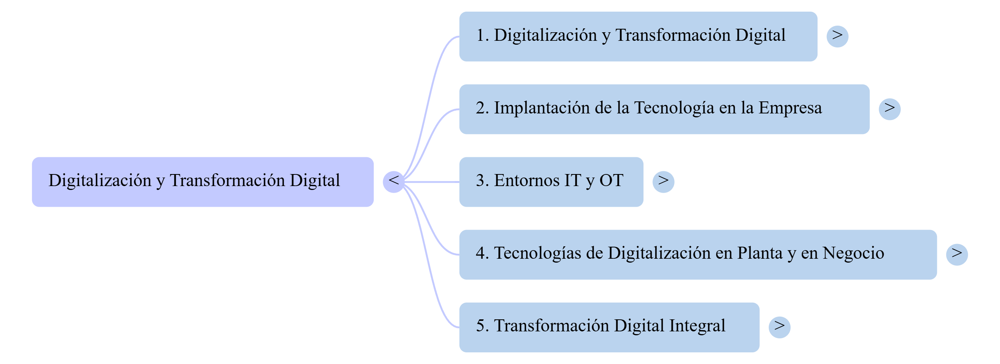

+++
title = "UD1. Digitalización en los sistemas productivos"
weight = 1
+++

| Duración | Resultado de aprendizaje |
|---|---|
| 4 horas | **RA1.** Analiza la digitalización en los sectores productivos e identifica los entornos IT y OT y su relación con la organización. |

### Contenidos de la UD1

- Concepto de digitalización y transformación digital.
- Digitalización frente a informatización.
- Impacto en la empresa, plan de digitalización y digitalización de procesos.
- Entornos IT y OT: diferencias, relación y aplicaciones.
- ERP, CRM, ventajas y riesgos de la transformación digital.

### Actividades de la UD1

- Cuestionario de conceptos básicos.
- Análisis de una empresa tradicional.
- Identificación de sistemas IT y OT.
- Elaboración de un esquema de digitalización.
- Actividad autoevaluable.

### Mapa de la unidad

## Apartados de la unidad

{}
