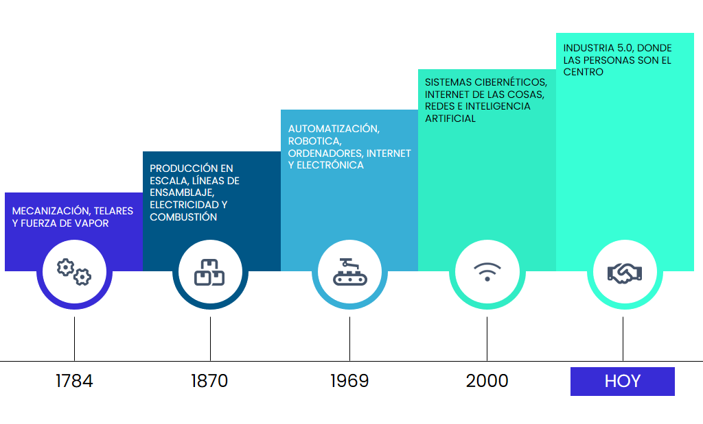

+++
title = "1. Tecnologías habilitadoras digitales (THD)"
weight = 1
+++

Los procesos de transformación digital tienen un impacto significativo en 
todos los sectores productivos y en los ciudadanos, ofreciendo grandes
oportunidades de empleo, innovación y emprendimiento, pero también
trayendo grandes desafíos y nuevos riesgos.

El factor de éxito más importante en la transformación digital es la rápida 
introducción de tecnologías digitales, así como su amplia gama competitiva
de productos y servicios, lo que sirve como catalizador para acelerar los
procesos de transformación digital y también como una importante oportunidad para el sector industrial de tecnologías digitales. Al conjunto de tecnologías clave, que actúan como facilitadores fundamentales para la transformación digital, se le conoce como tecnologías habilitadoras digitales. Estas tecnologías proporcionan la infraestructura y
las capacidades necesarias para impulsar la digitalización y aprovechar las
oportunidades que ofrece la era digital.

Algunas de las principales tecnologías habilitadoras digitales son:

- **Internet de las cosas (IoT):**
El IoT implica la conexión de dispositivos físicos a través de la red, permitiendo la recopilación y el intercambio de datos entre ellos. Esto posibilita la automatización, la monitorización en tiempo real y la toma de decisiones, lo que tiene aplicaciones en diversas industrias como la salud, la agricultura, la manufactura y la logística.

- **Inteligencia artificial (IA):**
La IA involucra sistemas informáticos que pueden realizar tareas que normalmente requieren inteligencia humana. Esto incluye el aprendizaje automático, el procesamiento de lenguaje natural, la visión por computadora y otras disciplinas que permiten a las máquinas aprender y realizar funciones complejas.

- **Big data y analítica:**
Estas tecnologías se centran en la gestión y el análisis de grandes volúmenes de datos. El big data aborda la recopilación y almacenamiento de datos a gran escala, mientras que la analítica se enfoca en extraer conocimientos y patrones significativos a partir de esos datos. Estas tecnologías son fundamentales en la investigación científica, la personalización de servicios, la mejora de la eficiencia operativa y el desarrollo de estrategias comerciales basadas en datos.

- **Blockchain:**
Esta tecnología de registro distribuido proporciona una gestión segura y transparente de transacciones. Se utiliza comúnmente en aplicaciones financieras, pero también tiene aplicaciones en la cadena de suministro, la gestión de contratos y la autenticación. Su característica de descentralización y seguridad ha llevado a su adopción en diversas áreas donde la confianza y la transparencia son cruciales.

- **Computación en la nube:**
La computación en la nube implica el acceso a recursos informáticos, como almacenamiento, procesamiento y aplicaciones, a través de una infraestructura de red que puede ser local, remota (internet) o una mezcla de ambas. Permite la escalabilidad, la flexibilidad y el acceso bajo demanda a recursos tecnológicos sin la necesidad de poseer o mantener infraestructuras físicas.

- **Realidad aumentada (RA):**
La realidad aumentada combina elementos del mundo real con elementos virtuales, superponiendo información digital (como gráficos, sonido o datos) sobre la vista del mundo real a través de dispositivos como teléfonos inteligentes, tabletas o gafas especiales. Esto permite a los usuarios interactuar con el entorno real mejorado por la información digital, lo que tiene aplicaciones significativas en áreas como la formación, la asistencia técnica, el marketing y los juegos.

- **Realidad virtual (RV):**
La realidad virtual sumerge completamente a los usuarios en un entorno digital simulado, a menudo a través de dispositivos como gafas de realidad virtual. Este entorno artificial puede ser completamente ficticio o una representación digital de un entorno real. La RV se utiliza en diversas áreas, desde simulaciones de entrenamiento y experiencias hasta aplicaciones médicas y terapias virtuales.

- **Impresión 3D:**
La impresión 3D, también conocida como fabricación aditiva, es una tecnología habilitadora digital que ha transformado significativamente la forma en que se diseñan y producen objetos. Esta tecnología ha democratizado el proceso de fabricación al permitir que pequeñas empresas, laboratorios de investigación y entusiastas creen productos de manera accesible y eficiente.

- **Ciberseguridad IT y OT:**
La ciberseguridad IT y OT busca garantizar la seguridad y resiliencia en entornos digitales interconectados. La parte IT se enfoca en proteger datos y activos digitales, prevenir amenazas cibernéticas y gestionar identidad y acceso. La parte OT se centra en la seguridad de sistemas de control industrial, la integración segura de dispositivos IoT industriales y la resiliencia de infraestructuras críticas. La ciberseguridad, tanto IT como OT, es una tecnología habilitadora digital que, por su naturaleza, se considera transversal a todas las demás, ya que cualquier entorno digital necesita disponer de sus propias medidas de seguridad y privacidad.

- **Gemelos digitales:**
Los gemelos digitales son una tecnología habilitadora digital que crea representaciones precisas en tiempo real de objetos físicos o sistemas. Permiten la simulación, el análisis predictivo y la optimización de procesos en diversos campos, como fabricación, salud y gestión de activos. Se integran con IoT para recopilar datos en tiempo real, facilitando la toma de decisiones informadas. En la industria, se utilizan para la gestión de activos, mantenimiento predictivo y diseño de productos. También tienen aplicaciones en medicina, realidad aumentada y virtual, mejorando la eficiencia operativa y la toma de decisiones en diversos sectores.

- **Robótica colaborativa:**
La robótica colaborativa es una tecnología habilitadora digital que facilita la colaboración segura entre robots y seres humanos en entornos de trabajo compartidos. Ofrece flexibilidad en la automatización, optimización de procesos e integración con tecnologías digitales. Además, encuentra aplicaciones en diversos sectores, como la manufactura y la salud. Destaca por su capacidad de aprendizaje colaborativo y la implementación de interfaces intuitivas, contribuyendo a la eficiencia y transformación digital en entornos laborales.

- **Redes 5G:**
La quinta generación de tecnologías de red móvil, comúnmente conocida como 5G, representa un avance significativo en las capacidades de conectividad inalámbrica. Estas redes están diseñadas para ofrecer velocidades de transmisión de datos mucho más rápidas, menor latencia y una mayor capacidad de conexión simultánea en comparación con sus predecesoras, como 4G. Las redes 5G son un componente fundamental en el ecosistema de tecnologías habilitadoras digitales, ya que proporcionan la infraestructura de conectividad necesaria para el funcionamiento eficiente de las tecnologías mencionadas anteriormente. La capacidad de transmitir grandes volúmenes de datos de manera rápida y confiable impulsa la adopción y el rendimiento efectivo de estas tecnologías en diversos entornos, desde las grandes empresas hasta los hogares.

Las primeras integraciones de THD en la industria surgieron hace aproximadamente una década. Su aparición dio lugar a un nuevo modelo que se denominó industria 4.0, en el que había una apuesta clara por digitalizar y automatizar procesos.

Sin embargo, la evolución de las THD ha hecho que cambie el paradigma y que la tecnología no se use simplemente como un apoyo. Ahora los dispositivos tienen un papel mucho más relevante: son capaces de generar conocimiento por su cuenta y de tomar decisiones con base en un tratamiento de datos que realizan de forma autónoma. Esta nueva era se conoce como industria 5.0.

