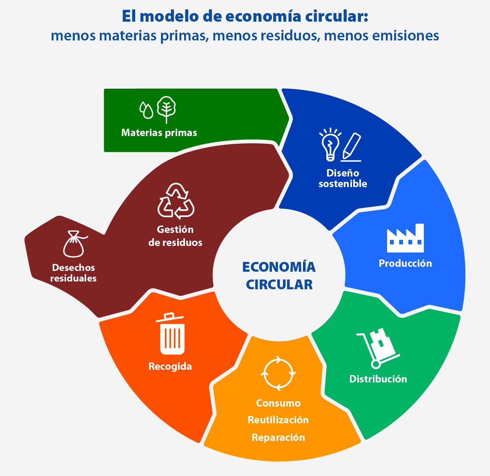

+++
title = "3. Las THD y la economía sostenible"
weight = 3
+++

La sostenibilidad requiere medir, reducir y compensar impactos ambientales y sociales a lo largo de cadenas de valor globales. Las THD proporcionan medición granular, transparencia y optimización. Sensórica y plataformas IoT cuantifican consumos de energía, agua y materias primas. La analítica y la IA identifican ineficiencias, recomiendan ajustes operativos y evalúan escenarios de reducción de emisiones. Blockchain y pasaportes digitales de producto mejoran la trazabilidad de materiales críticos y certificaciones. La nube facilita reportes ESG auditables y colaborativos, mientras RA/RV acelera formación segura y eficiente. La fabricación aditiva minimiza desperdicios y permite reparabilidad. Los gemelos digitales simulan impactos de cambios de diseño antes de producirlos a escala. Integradas, estas capacidades habilitan economía circular, simbiosis industrial y cadenas de suministro resilientes y bajas en carbono. Además, marcos de ciberseguridad y privacidad aseguran confianza en el intercambio de datos entre socios, condición clave para escalar la sostenibilidad.

## 3.1 Tipo de economía

Históricamente ha predominado la economía lineal (extraer–producir–usar–desechar), intensiva en recursos y emisiones. La transición actual prioriza modelos alternativos: 
- Economía circular (diseño para durabilidad, reutilización, reparación, remanufactura y reciclaje)
- Economía del desempeño (pagar por función en lugar de propiedad) 
- Economía colaborativa (compartición de activos infrautilizados)

## 3.2 Modelos de negocio sostenible

Los modelos sostenibles priorizan valor a largo plazo, menor huella ambiental y beneficios sociales. Destacan _Product-as-a-Service (PaaS)_, donde el fabricante mantiene propiedad y responsabilidad del rendimiento; mantenimiento predictivo as-a-service, que alinea incentivos con fiabilidad; plataformas de reutilización y reacondicionamiento; y cadenas de suministro con certificación de origen e impacto.

Las THD hacen viables estos modelos: 
- Sensores y conectividad permiten facturar por uso y asegurar SLA.
- Analítica y IA personalizan servicios y optimizan costes.
- Blockchain facilita contratos inteligentes y verificación de materiales.
- RA/RV reduce desplazamientos y huella de formación. 
 
La fabricación aditiva acorta reposición de repuestos y promueve reparabilidad. Para escalar, se requiere gobierno del dato robusto, integración con sistemas ERP/PLM y mecanismos de reporte ESG confiables. La propuesta de valor pasa por combinar desempeño, transparencia y costes totales competitivos.

## 3.3 Las THD en los modelos de negocio sostenible
Los actuales niveles de consumo y producción son insostenibles. La presión regulatoria, de inversores y consumidores impulsa a las empresas a adoptar modelos más sostenibles. Si continuan  los patrones de consumo actuales se necesitarán 2 planetas para 2030. La transición a una economía circular y baja en carbono es urgente.

Para evitar esto debemos proponer modelos de negocio sostenible que integren las THD en todas las fases del ciclo de vida del producto, desde el diseño hasta el reciclado. A continuación se describen siete modelos clave donde las THD juegan un papel fundamental.
- Extensión de la vida del producto
- Producto como servicio (PaaS)
- Producción JIT
- Simbiosis industrial
- Ecodiseño
- Cadena de suministro sostenible
- Reciclado y reconversión
  

### 3.3.1 Extensión de la vida del producto
Extender la vida útil reduce extracción de recursos y emisiones incorporadas. 
- IoT captura horas de uso, condiciones ambientales y patrones de operación facilitando el mantenimiento predictivo.
- IA identifica degradación temprana y recomienda ajustes o sustituciones puntuales. 
- La RA habilita mantenimiento guiado, disminuyendo errores y tiempos de parada. 
- La impresión 3D facilita fabricación rápida de piezas descatalogadas, 
- Los gemelos digitales simulan impacto de intervenciones sobre rendimiento y seguridad. 
- Con blockchain se certifican reparaciones y repuestos, preservando garantía y valor residual.

Estos elementos permiten pasar de mantenimiento correctivo a predictivo y prescriptivo, maximizando MTBF y minimizando coste total de propiedad. Además, el diseño para mantenimiento se apoya en datos reales para futuras iteraciones, cerrando el aprendizaje entre campo e ingeniería. El resultado es un portafolio más durable, con ingresos recurrentes por servicio y menor volumen de residuos.

### 3.3.2 Producto como servicio (PaaS)

El modelo Producto como servicio desplaza el valor de la venta puntual a la entrega de desempeño y resultados, alineando incentivos de fabricante y cliente hacia durabilidad, disponibilidad y eficiencia. 

Las THD lo habilitan extremo a extremo: 
- IoT mide uso y condición para facturación por consumo y cumplimiento de SLA.
- la IA predice fallos y prescribe intervenciones para maximizar disponibilidad.
- la nube orquesta suscripciones, contratos y portales de cliente.
- los gemelos digitales comparan desempeño real vs. esperado para optimizar diseño y operación.
- Blockchain registra eventos de mantenimiento y uso, aportando evidencias auditables y transferencia de responsabilidad cuando proceda.
- La ciberseguridad protege activos conectados y datos de uso.
- 5G y edge reducen latencia en entornos críticos.
- La impresión 3D acelera repuestos bajo demanda, mejorando tiempos de servicio.
 
Integrado con ERP/CRM, el PaaS cierra el ciclo de vida con KPIs de negocio y sostenibilidad (disponibilidad, coste por hora de servicio, CO₂e por unidad de uso), fomentando diseño para mantenimiento y circularidad.

### 3.3.3 Producción JIT

La producción Just-In-Time (JIT) reduce inventarios y tiempos de ciclo, pero exige sincronización precisa. Las THD aportan visibilidad de punta a punta: 
- proveedores conectados comparten disponibilidad y calidad en tiempo real mediante IoT y portales en la nube; 
- la analítica pronostica demanda y ajusta planes MRP; y 
- 5G conecta células productivas y AGVs con latencias bajas. La visión artificial valida componentes al llegar, y 
- la robótica colaborativa acelera cambios de referencia. 
- Los gemelos digitales simulan secuencias para minimizar cuellos de botella y/o holguras.
- Blockchain registra entregas y certificaciones, reduciendo disputas. 
- La ciberseguridad OT segmenta redes y protege PLCs. 
 
Con esta base, el JIT se vuelve resiliente, capaz de reaccionar a perturbaciones con replanificación dinámica y buffers virtuales.

### 3.3.4 Simbiosis industrial

La simbiosis industrial convierte subproductos de unas operaciones en recursos de otras. Para coordinarla se requieren datos fiables de cantidades, calidad y temporalidad. 
- Las plataformas en la nube y marketplaces industriales, apoyados por IA, casan oferta y demanda de residuos valorizables (calor, agua, compuestos, embalajes). 
- Sensores y pasarelas IoT verifican características y condiciones de transporte; 
- Blockchain registra acuerdos, cumplimiento y métricas de impacto.
- Los gemelos digitales evalúan beneficios energéticos y de emisiones antes de invertir. 
- La ciberseguridad y la gestión de identidad facilitan intercambio de datos sin exponer secretos comerciales. 

Este enfoque crea economías locales más eficientes, reduce costes de eliminación y abre nuevas líneas de ingreso. Políticas de datos y estándares abiertos potencian la interoperabilidad entre parques industriales y municipios, escalando los efectos de red.

### 3.3.5 Ecodiseño

El ecodiseño incorpora criterios ambientales desde la concepción: menor número de piezas, materiales reciclables, desmontaje sencillo y eficiencia energética. Las herramientas CAD integradas con bases de datos de ACV (análisis de ciclo de vida) cuantifican impactos de alternativas de materiales y procesos. 
- La IA sugiere topologías ligeras y optimizadas que la impresión 3D puede materializar con menos desperdicio. 
- Los gemelos digitales simulan consumo y durabilidad bajo distintos escenarios, evitando sobreingeniería. 
- La trazabilidad con blockchain permite pasaportes digitales que informan composición y rutas de recuperación. 
- RA apoya instrucciones de desmontaje y clasificación al final de vida. 
 
Este enfoque reduce huella de carbono incorporada y mejora la reparabilidad, habilitando modelos de depósito y retorno. La colaboración en la nube conecta diseño, compras y proveedores para seleccionar opciones con menor impacto sin sacrificar coste ni desempeño.

### 3.3.6 Cadena de suministro sostenible

Una cadena de suministro sostenible es el conjunto de procesos y relaciones que, desde el origen de los materiales hasta el fin de vida del producto, minimiza impactos ambientales y sociales y asegura la viabilidad económica. Una cadena sostenible requiere trazabilidad, evaluación de riesgos y colaboración. 

- Los sensores capturan condiciones de transporte (temperatura, golpes), y 5G/LPWAN garantizan conectividad continua. 
- Las plataformas de datos (blockchain) agregan huellas de carbono por lote, combinando factores de emisión certificados. Con contratos inteligentes se automatizan auditorías y verificación de origen responsable. 
- La fabricación JIT acerca la producción a demanda, recortando kilómetros logísticos.
- La ciberseguridad y el control de acceso basado en roles protegen datos entre partners. 
  
Esto se traduce en una cadena de suministro más sólida y capaz de afrontar imprevistos, reduce los costes asociados a defectos y problemas de calidad, y proporciona pruebas verificables del cumplimiento de los compromisos ambientales, sociales y de gobernanza (ESG) frente a clientes y organismos reguladores.

### 3.3.7 Reciclado y reconversión

El reciclado y la reconversión requieren información precisa sobre composición, desmontaje y tratamientos. Los pasaportes digitales de producto, alimentados desde el diseño, agilizan clasificación y separación. 
- La visión artificial identifica materiales en cinta y mejora purezas; robots colaborativos apoyan desmontaje seguro. 
- La analítica optimiza rutas de recogida y dimensiona capacidad de plantas. Con RA se guía a operarios en procesos complejos y se reducen siniestros. 
- La impresión 3D revaloriza residuos transformándolos en nuevos componentes o útiles de producción. 
- Blockchain asegura cadena de custodia, cumpliendo regulaciones y evitando greenwashing[^1]. 
- Los gemelos digitales evalúan inversiones en nuevas líneas y simulan mezclas para maximizar rendimiento y rentabilidad. 
 
Este enfoque convierte el final de vida en una fuente de materiales secundarios de calidad, cerrando ciclos y reduciendo dependencia de materias primas vírgenes.

[^1]: Greenwashing: práctica de marketing que da una imagen falsa de responsabilidad ambiental.

