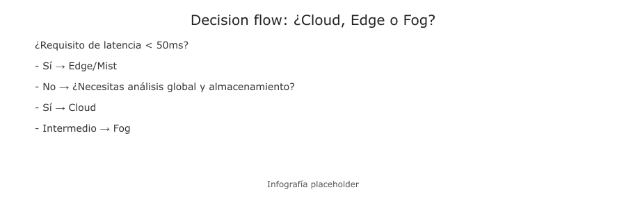
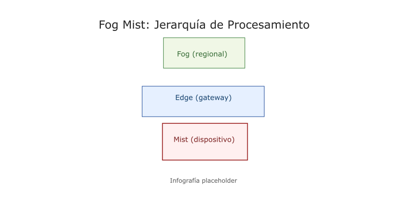

+++
title = "5. Edge computing"
weight = 5
+++

## 5.1 Concepto y fundamentos

Desde el punto de vista técnico, diseñar para el **edge** significa aceptar heterogeneidad: distintos procesadores (**ARM**, **x86**), aceleradores (**GPU**, **NPU**, **TPU**), capacidades de memoria y conectividades. Esto obliga a abstraer despliegues mediante **contenedores ligeros** y runtimes que soporten cross-compilation y modelos quantizados que reduzcan tamaño y **latencia** de inferencia. El uso de formatos estándar como **ONNX** facilita portar modelos entre plataformas; al mismo tiempo, frameworks como **TensorFlow Lite** o **PyTorch Mobile** permiten optimizaciones específicas. En redes, los patrones híbridos (procesado local + sincronización eventual con la nube) reducen el ancho de banda consumido y mejoran **resiliencia**. Para cargas críticas, el diseño debe contemplar redundancia local y estrategias de failover, por ejemplo replicando funciones clave entre varios nodos o manteniendo capacidades mínimas en la nube para tomar el control si el borde falla. Finalmente, la automatización del pipeline — desde **CI/CD** de modelos hasta despliegues **OTA** seguros— es vital para mantener consistencia operativa en miles de nodos distribuidos.

El **edge computing** acerca el procesamiento de datos al lugar donde se generan para reducir **latencia**, ahorrar ancho de banda y permitir respuestas en tiempo real. Se aplica en escenarios donde la rapidez de respuesta o la **privacidad** de los datos son críticas: control industrial, vehículos autónomos, dispositivos médicos conectados y análisis de video en cámaras de vigilancia.

Técnicas comunes: microservicios y **contenedores ligeros** (ej. **Docker**), orquestación local (**Kubernetes/K3s**), modelos de inferencia optimizados (quantization, pruning) y runtime especializados (**TensorRT**, **ONNX Runtime**). Protocolos habituales: **MQTT**, **CoAP**, **gRPC** y **HTTP/2** para comunicación eficiente.

### Ejemplos
- Clasificador de vibraciones en un **PLC** que solo transmite alertas al sistema central para ahorrar ancho de banda.
- Cámara de seguridad que ejecuta detección de personas localmente y solo sube clips tras confirmación.

### Casos reales
- **Siemens** y **Bosch**: inferencia local para **mantenimiento predictivo** en líneas de producción, reduciendo downtime en 30%.
- **Philips Healthcare**: procesamiento local en equipos de diagnóstico para acelerar resultados, mejorando precisión en IA médica.

### Enlaces
- **ONNX**: https://onnx.ai – Estándar abierto para portabilidad de modelos, con tutoriales prácticos.
- **TensorFlow Lite**: https://www.tensorflow.org/lite – Framework para edge, con ejemplos de código para dispositivos móviles.
- **MQTT**: https://mqtt.org – Protocolo ligero para IoT, con guías de implementación.

**Resumen:** **Edge computing** fundamental para **latencia baja** y **privacidad**, con arquitectura híbrida y herramientas como **ONNX** y **TensorFlow Lite**, aplicado en **Siemens** y **Philips** para mantenimiento y diagnóstico, equilibrando eficiencia y resiliencia.

## 5.2 Diferencias con la nube tradicional

El **edge** complementa la nube en una jerarquía: **mist** (dispositivo) → **edge** (gateway/local node) → **fog** (regional aggregation) → nube (entrenamiento/almacenamiento global). La nube se encarga de entrenamiento de modelos, almacenamiento histórico y coordinación; el **edge** ejecuta inferencias, acciones locales y preprocesado de datos.

El **edge** y la nube son compañeros de trabajo: la nube aporta memoria, contexto y aprendizaje a largo plazo; el **edge** aporta rapidez y respuesta local. Desde un punto de vista práctico, hay que decidir qué datos deben ser procesados al instante (alertas, controles, inferencias críticas) y cuáles pueden agregarse y enviarse a la nube para análisis históricos o reentrenamiento. Esa decisión depende de la **latencia** aceptable, del **coste** de transmitir datos y de requisitos regulatorios.

Para que esta colaboración funcione se recomienda usar **APIs** estables y formatos interoperables (por ejemplo **JSON** o **Protobuf**), diseñar contratos de datos claros y emplear gateways como puntos de agregación y traducción de protocolos. Separar el plano de control (orquestación, políticas) del plano de datos (telemetría e inferencia) hace que las actualizaciones sean más seguras y sencillas. En términos cotidianos: el borde reduce la cantidad de información que viaja; la nube aporta el conocimiento que mejora las decisaiones futuras.

### Ejemplos, casos y recursos
- Ejemplo práctico: un gateway que agrega datos de sensores y solo envía resúmenes o alertas, reduciendo ancho de banda.
- Caso real: **Amazon Wavelength / MEC**, que integra **edge** con operadores móviles para servicios de baja **latencia** en 5G.
- Recursos útiles: **NIST Edge Computing report** (https://www.nist.gov/publications) – Marco estandarizado con diagramas arquitectónicos.
- **GSMA MEC** (https://www.gsma.com/future-networks/) – Casos de telecom con infografías de jerarquías edge-nube.
- Infografía: 

**Resumen:** **Edge** difiere de la nube tradicional por su enfoque en **latencia baja** y procesamiento local, complementándola en jerarquías híbridas, como en **Amazon Wavelength**, con patrones como **cloud-assisted inference** para equilibrar rapidez y escalabilidad.

**Tabla jerarquía y características**
| Capa | Latencia objetivo | Persistencia | Ejemplo acción | Energía disponible |
|------|------------------|--------------|----------------|--------------------|
| Mist | < 5 ms           | Mínima       | Interrumpir motor | Muy baja |
| Edge | 5–20 ms          | Local parcial| Agregar eventos | Moderada |
| Fog  | 20–100 ms        | Agregada     | Correlacionar sitios | Media |
| Cloud| >100 ms (no crítica) | Completa | Entrenar modelo | Alta |

## 5.3 Casos de uso actuales

El diseño de casos de uso para **edge** exige una aproximación por dominio: en el sector industrial la prioridad es la disponibilidad y la determinación temporal (**hard real-time** en control de procesos), en salud la **privacidad** y la trazabilidad, y en telco la integración con infraestructura de red y gestión de slices. Para cada dominio conviene definir un mapa de requisitos que incluya **latencia** objetivo, criticidad de la decisión, volumen de datos por hora y requisitos regulatorios. Este mapeo guía la selección de hardware (por ejemplo, usar **Jetson/NVIDIA** cuando hay vídeo y modelos pesados o microcontroladores con aceleradores **NPU** para sensores con baja potencia) y la estrategia de despliegue (centrado en gateways vs. completamente distribuido).

El **edge** resulta especialmente valioso cuando la rapidez de respuesta importa, cuando hay mucho volumen de datos o cuando la **privacidad** exige que cierta información no salga del entorno local. En la industria, el objetivo suele ser evitar paradas y reducir fallos; en salud, proteger datos sensibles y avisar a tiempo a personal médico; en telecomunicaciones, aprovechar **5G** para ofrecer experiencias interactivas sin **latencia** apreciable. 

### Ejemplos, casos y recursos
- Ejemplos prácticos: plataformas de gestión de flotas, sistemas de monitoreo de salud que alertan solo ante anomalías, cámaras que procesan video y envían metadatos.
- Casos reales: **Siemens**, **Bosch**, **Jaguar Land Rover**, **Philips Healthcare** – En manufactura, **Siemens** usa **edge** para mantenimiento predictivo, reduciendo downtime 30%.
- Recursos: **Intel Edge AI** (https://www.intel.com/content/www/us/en/artificial-intelligence/edge-ai.html) – Kit de desarrollo con casos prácticos.
- Infografía: 

**Resumen:** Casos de **edge** varían por dominio, con mapeo de **latencia** y pruebas para validación, como en **Siemens** para industrial y **Philips** para salud, optimizando **TCO** y calidad en despliegues distribuidos.

### 5.4 Herramientas y plataformas
- **AWS IoT Greengrass / AWS Wavelength**
- **Azure IoT Edge / Azure Stack Edge**
- **Google Distributed Cloud Edge**
- **EdgeX Foundry**, **K3s (Rancher)**, **Balena**, **OpenNESS**
- Frameworks **ML**: **TensorFlow Lite**, **ONNX Runtime**, **NVIDIA Jetson/TensorRT**

### Ejemplos
- Despliegue de **K3s** en gateways con **contenedores** que exponen **APIs REST** para la lógica local.

### Casos reales
- **EdgeX Foundry** implementado por integradores para unificar telemetría en fábricas, como en **Bosch** para IoT industrial.

### Enlaces
- **EdgeX Foundry**: https://www.edgexfoundry.org – Plataforma open-source con demos para IoT edge.
- **K3s**: https://k3s.io – Guía ligera de Kubernetes para edge, con ejemplos de código.
- **Balena**: https://www.balena.io – Casos de despliegue OTA en dispositivos remotos.

## 5.4 Ventajas clave del **edge computing**: 

El valor del **edge** suele entenderse mejor con ejemplos prácticos: imagina una línea de producción en la que un sensor detecta vibraciones anómalas. Si ese dato tiene que viajar hasta la nube y volver, la reacción puede llegar demasiado tarde; con procesamiento en el borde, la máquina puede reducir ritmo o apagarse automáticamente, evitando daños mayores. Ese tipo de mejoras se traducen en métricas sencillas y útiles para la toma de decisiones: **latencia** desde la detección hasta la acción, porcentaje de decisiones resueltas localmente, ahorro en GB transferidos y reducción del tiempo de parada no planificado. Para proyectos educativos o pilotos, medir estas variables antes y después del despliegue proporciona una historia clara sobre el impacto del **edge**.

En otras palabras: si el objetivo del negocio es reducir tiempos de respuesta o ahorrar en comunicaciones, el **edge** puede ser la herramienta adecuada. Los equipos deben definir desde el principio las métricas clave (**SLA** de **latencia**, umbrales de alertas, volumen de datos esperado) y diseñar experimentos que permitan medir mejoras de forma objetiva. Estas métricas facilitan también la comunicación con dirección y finanzas, porque enlazan el trabajo técnico con resultados medibles que impactan al negocio.

- **Latencia reducida**: Procesar datos cerca de su origen permite respuestas en tiempo real, crucial en aplicaciones como vehículos autónomos o control industrial.

- **Ahorro de ancho de banda**: Al filtrar y procesar datos localmente, se reduce la cantidad de información que viaja a la nube, lo que ahorra **costes** de transmisión.
- **Mayor privacidad**: Los datos sensibles pueden ser procesados y almacenados localmente, minimizando riesgos de exposición.
- **Resiliencia operacional**: La capacidad de operar de forma autónoma en caso de pérdida de conexión con la nube.

### Ejemplos
- Medir **latencia** antes y después del despliegue para validar cumplimiento de **SLA**.
- Cuantificar GB/día ahorrados tras implementar filtrado local.

### Casos reales
- Empresas manufactureras como **Siemens** que han reducido tiempos de parada tras implementar detección local de fallos, ahorrando millones en mantenimiento.

### Enlaces
- **Azure IoT Edge**: https://azure.microsoft.com/en-us/services/iot-edge/ – Tutoriales con labs virtuales para probar ventajas en resiliencia.

**Resumen:** Las **ventajas** del **edge** incluyen **latencia reducida**, **ahorro de ancho de banda** y **mayor privacidad**, con herramientas como **K3s** y **EdgeX**, aplicadas en **Siemens** para mantenimiento, midiendo impacto con KPIs como **SLA** para ROI claro.

## 5.5 Limitaciones y retos

Desplegar **edge** a escala introduce retos operativos: imagina tener cientos de pequeñas cajas conectadas por la ciudad. Cada una necesita actualizaciones, parches y supervisión; sin una plataforma que automatice estos procesos, el **coste** humano crece rápido. Por eso las mejores prácticas pasan por automatizar despliegues (**OTA**), monitorizar de forma centralizada y diseñar planes de recuperación que permitan que los dispositivos sigan funcionando con capacidades limitadas cuando la conexión a la nube falla.

En **seguridad**, la recomendación práctica es combinar medidas de software y hardware: usar arranque seguro para evitar que un dispositivo ejecute código malicioso, almacenar claves en módulos seguros tipo **TPM**, y cifrar comunicaciones. Pero no basta con tecnologías: hay que operar con procesos claros: inventario de dispositivos, ciclos de parcheo definidos, y pruebas periódicas de **seguridad**. Con estas prácticas se reduce el riesgo y se facilita la escalabilidad del proyecto.

### Ejemplos
- Estrategia **OTA** para actualizar modelos de inferencia con canary rolls y rollback automático.

### Casos reales
- Operadores telco como **Verizon** que automatizan parches de **seguridad** en nodos **MEC** y gateways, reduciendo vulnerabilidades en 5G.

### Enlaces
- Guía **mTLS / TLS mutuo**: https://www.openssl.org – Documentación técnica con ejemplos de código para autenticación edge.
- **OWASP IoT Security**: https://owasp.org/www-project-internet-of-things/ – Checklist didáctica para mitigar riesgos en despliegues distribuidos.

## 5.6 Costes y retorno de la inversión (ROI)

Hablar de **costes** suele asustar a las organizaciones, pero lo más útil es transformar **costes** en hipótesis que podamos validar con pilotos. Un piloto bien diseñado estima tanto **costes directos** (hardware, energía, comunicaciones) como beneficios tangibles (reducción de paradas, ahorro en ancho de banda, mejora en tiempos de respuesta). Una vez puestos números sobre la mesa, se puede comparar la alternativa «todo en la nube» frente a «procesado parcial en el borde» con claridad.

Además, hay modelos mixtos: en lugar de comprar y mantener todo el hardware, es posible contratar servicios gestionados de **edge** o alquilar nodos en modalidad "**as-a-service**". Estos modelos reducen la barrera de entrada y permiten validar hipótesis sin comprometer grandes inversiones iniciales. Para presentar **ROI**, conviene mostrar escenarios (optimista, realista, conservador) y el plazo esperado de recuperación, normalmente en meses a uno o dos años dependiendo del caso.

**Ejemplos y casos reales:**
* **Ejemplo:** **Jaguar Land Rover** calculó **ROI** de **edge** en telemetría vehicular, recuperando inversión en 12 meses por reducción de downtime.
* **Caso real:** **Amazon Wavelength** ofrece **edge as-a-service** para desarrolladores, bajando **costes** iniciales en 70% vs. hardware propio.
* **Enlace:** [ROI Edge - CloudTweaks](https://cloudtweaks.com/2025/09/cloud-exit-economics-real-world-roi-financial-models/) – Modelo financiero con calculadoras interactivas para escenarios edge.
* **Tabla comparativa rápida:**

| Escenario     | Coste Inicial | ROI Tiempo | Ejemplo              |
| ------------- | ------------- | ---------- | -------------------- |
| Piloto        | Bajo          | 6 meses    | Jaguar Land Rover    |
| As-a-service  | Medio         | 12 meses   | Amazon Wavelength    |
| Full Deploy   | Alto          | 18-24 meses| Siemens (industrial) |

**Resumen:** **Costes** en **edge** se validan con pilotos para **ROI** rápido, como en **Jaguar Land Rover** (12 meses), usando modelos **as-a-service** para minimizar inversión inicial y maximizar resiliencia.

**Mini calculadora conceptual (texto)**
> ROI ≈ (Ahorro anual paradas + Ahorro ancho de banda + Reducción soporte) – (CapEx hardware + OpEx gestión + Formación)

**Indicadores recomendados**
- % reducción downtime
- p95 latencia decisión
- GB filtrados local vs crudos
- Tiempo despliegue nodo (min)
- Coste operativo mensual / nodo

## 5.7 Lecturas y referencias y cierre práctico

Para cerrar, proponemos una pequeña guía práctica: empezar por un piloto corto y medible.

### Ejemplos, casos, enlaces y tabla resumen
- Casos reales: **Siemens**, **Bosch**, **Philips Healthcare**, **Jaguar Land Rover**, **Amazon Wavelength** – **Siemens** integra **edge** con IA para fábricas inteligentes.
- Enlaces y recursos: **AWS Edge overview** (https://aws.amazon.com/edge/) – Portal con whitepapers y labs gratuitos.
- **Intel Edge AI** (https://www.intel.com/content/www/us/en/artificial-intelligence/edge-ai.html) – Recursos educativos con videos.
- **EdgeX Foundry** (https://www.edgexfoundry.org) – Comunidad open-source con foros.
- **Balena** (https://www.balena.io) – Plataforma con casos de IoT edge.
- Ejemplos prácticos: cámaras que envían metadatos, **PLCs** con detección local de vibraciones, gateways que agregan y normalizan telemetría.

**Resumen:** Guía práctica para **edge**: inicia con pilotos midiendo **KPIs** clave, usando recursos como **AWS** y **Intel**, con casos como **Siemens** demostrando escalabilidad, cerrando con automatización para operación eficiente.
