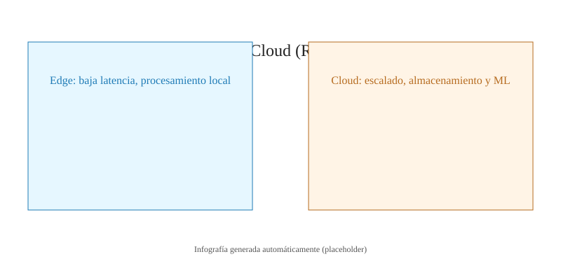
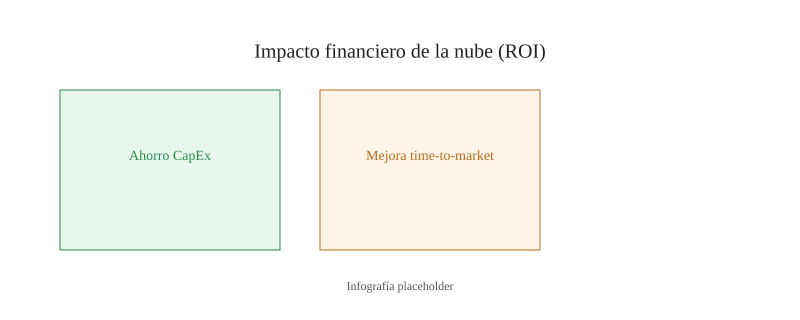

+++
title = "6. Fog computing y mist computing"
weight = 7
+++

## Tabla síntesis — Capítulo 6

| Caso | Beneficio | Métrica |
|------|-----------|---------|
| Vídeo analítica | Filtrado local | Ancho de banda ahorrado |
| IoT industrial | Latencia baja | Tiempo de ciclo |
| Salud | Datos sensibles locales | Cumplimiento |

## Tips y curiosidades — Capítulo 6

- Tip: separa plano de control y de datos para escalar por capas.
- Curiosidad: algunos dispositivos integran TPM incluso en microcontroladores.

> Mapa rápido fog/mist
> - Mist: decisión micro (sensor) → prioriza latencia y energía.
> - Fog: agrega y resume datos de múltiples mist.
> - Función: aliviar nube y reducir tráfico.
> - Clave: segmentar qué se procesa dónde.

## 6.1 Definición de fog computing

El **fog computing** es un modelo de computación distribuida que extiende los servicios de la nube hacia la **periferia de la red**, cerca de los dispositivos que generan datos. Su objetivo es **reducir la latencia** y mejorar la eficiencia en el procesamiento, almacenamiento y análisis de información, especialmente en aplicaciones que requieren **respuesta en tiempo real**, como vehículos autónomos, ciudades inteligentes o **IoT** industrial.

A diferencia de la nube tradicional, en la que los datos viajan hasta centros de datos remotos, el **fog computing** procesa información en nodos intermedios, como routers, gateways o servidores locales. Esto permite **filtrar, analizar y reaccionar rápidamente** ante eventos críticos sin depender completamente de la nube. Además, mejora la **seguridad**, ya que parte de los datos sensibles puede permanecer en la red local antes de enviarse al centro de datos.

**Ejemplos y casos reales:**
* **Ejemplo:** En ciudades inteligentes, sensores de tráfico procesan datos en nodos **fog** para ajustar semáforos en tiempo real, optimizando flujo vehicular.
* **Caso real:** **Cisco Fog Computing Platform** ofrece infraestructura **fog** para **IoT** industrial, usada por utilities para monitoreo de grids energéticos.
* **Enlace:** [Cisco Fog Computing](https://www.cisco.com/c/en/us/solutions/internet-of-things/fog-computing.html) – Whitepaper con diagramas de arquitectura fog para IoT.
* **Tabla comparativa rápida:**

| Característica | Función                  | Beneficio                |
| -------------- | ------------------------ | ------------------------ |
| Procesamiento intermedio | Filtrado local           | Reducción latencia       |
| Seguridad     | Datos locales            | Menor exposición         |
| Eficiencia    | Análisis en nodos        | Ahorro ancho de banda    |

**Resumen:** **Fog computing** extiende la nube a la periferia para **latencia baja** y **eficiencia**, como en **Cisco** para grids, filtrando datos localmente y mejorando **seguridad** en **IoT**.

## 6.2 Definición de mist computing

El **mist computing** lleva el concepto de **fog computing** un paso más cerca del **dispositivo final**, realizando procesamiento **en el mismo dispositivo o muy cerca de él**, incluso en sensores o actuadores **IoT**. Su objetivo principal es **minimizar la latencia al máximo**, optimizar el consumo energético y reducir la necesidad de enviar grandes volúmenes de datos a la nube o al **fog**.

**Mist computing** es especialmente útil en dispositivos con **capacidad limitada de almacenamiento o potencia**, como wearables, drones o sensores remotos. Permite que las decisiones se tomen localmente y solo se envíen a la nube los datos agregados o relevantes, disminuyendo la congestión de la red y mejorando la eficiencia global.

**Ejemplos y casos reales:**
* **Ejemplo:** Sensores en fábricas inteligentes que detectan fallos mecánicos y reaccionan localmente antes de alertar al sistema central, ahorrando energía.
* **Caso real:** **Libelium Mist Computing IoT** permite procesar datos directamente en nodos de sensores distribuidos, usado en agricultura para monitoreo remoto.
* **Enlace:** [Libelium Mist Computing](https://www.libelium.com/mist-computing-iot/) – Casos de estudio con métricas de ahorro energético en sensores.
* **Tabla comparativa rápida:**

| Característica | Función                  | Beneficio                |
| -------------- | ------------------------ | ------------------------ |
| Procesamiento extremo | En dispositivo           | Latencia mínima          |
| Eficiencia energética | Decisión local           | Bajo consumo             |
| Reducción datos | Envío selectivo          | Menos congestión         |

**Resumen:** **Mist computing** procesa en el **dispositivo final** para **latencia ultra-baja** y ahorro energético, como en **Libelium** para agricultura, extendiendo **IoT** sin sobrecargar redes.

## 6.3 Relación con el edge y la nube

El **fog y mist computing** se relacionan estrechamente con el **edge computing**, ya que todos buscan acercar el procesamiento a los datos. Mientras el **edge** generalmente procesa datos en dispositivos cercanos (como gateways o routers), el **mist** lo hace **directamente en los sensores** y el **fog** en **nodos intermedios de la red**, sirviendo como puente entre **edge** y nube.

Esta jerarquía permite **optimizar la distribución del procesamiento**: el **mist** realiza decisiones instantáneas en el dispositivo, el **fog** agrega y analiza datos a nivel local o regional, y la nube centraliza la información para análisis profundo, almacenamiento masivo y servicios de **inteligencia artificial** a gran escala. Así, se logra un **equilibrio entre velocidad, eficiencia y capacidad de cómputo**, adaptado a cada necesidad de la aplicación.

**Ejemplos y casos reales:**
* **Ejemplo:** Vehículos autónomos usan **mist** para detectar obstáculos, **fog** para coordinar tráfico local y nube para análisis global de patrones.
* **Caso real:** **Siemens MindSphere** combina **edge**, **fog** y nube para optimización industrial, integrando sensores en fábricas.
* **Enlace:** [Siemens MindSphere](https://new.siemens.com/global/en/products/software/mindsphere.html) – Plataforma con demos de jerarquía fog-edge-nube.
* **Tabla comparativa rápida:**

| Nivel        | Enfoque                   | Relación con nube         |
| ------------ | ------------------------ | ------------------------ |
| Mist         | Dispositivo final         | Decisión local, sync mínima |
| Fog          | Nodos intermedios         | Agregación, puente       |
| Edge         | Gateways cercanos         | Procesado periférico     |

**Resumen:** **Fog** y **mist** complementan **edge** y nube en jerarquías distribuidas, optimizando **latencia** y eficiencia, como en **Siemens MindSphere** para industrial, equilibrando procesamiento local y centralizado.

## 6.4 Aplicaciones prácticas

Las aplicaciones de **fog y mist computing** son amplias y se extienden a sectores que requieren **procesamiento rápido y confiable**:

* **Transporte:** vehículos autónomos, gestión de tráfico y sistemas de transporte inteligentes.
* **Industria:** fábricas inteligentes que detectan fallos o ajustan procesos en tiempo real.
* **Salud:** wearables que monitorizan signos vitales y alertan de emergencias sin enviar todos los datos a la nube.
* **Ciudades inteligentes:** gestión de semáforos, alumbrado público y sensores ambientales.

Estas aplicaciones muestran cómo **fog y mist computing** permiten decisiones inmediatas y **reducción de la latencia**, mientras que la nube centralizada se encarga de análisis global, almacenamiento y aprendizaje automático.

**Ejemplos y casos reales:**
* **Ejemplo:** **Philips** utiliza sensores **mist** en hospitales para monitorización continua de pacientes, alertando localmente emergencias.
* **Caso real:** **SmartSantander (España)** aplica **fog computing** para monitoreo ambiental urbano, procesando datos de sensores en nodos locales.
* **Enlace:** [SmartSantander IoT](https://www.smartsantander.eu/) – Proyecto abierto con datos reales y APIs para experimentación.
* **Tabla comparativa rápida:**

| Sector        | Aplicación                | Tecnología               |
| ------------- | ------------------------ | ------------------------ |
| Transporte    | Gestión tráfico           | Fog para semáforos       |
| Industria     | Mantenimiento predictivo  | Mist en sensores         |
| Salud         | Monitoreo wearables       | Mist para alertas        |

**Resumen:** Aplicaciones de **fog/mist** abarcan **transporte**, **industria** y **salud**, reduciendo **latencia** en tiempo real, como en **SmartSantander** y **Philips**, complementando nube para análisis global.

## 6.5 Retos de implementación

A pesar de sus ventajas, **fog y mist computing** enfrentan desafíos significativos:

* **Seguridad y privacidad:** al procesar datos fuera de la nube, la protección debe extenderse a múltiples nodos.
* **Interoperabilidad:** dispositivos, gateways y plataformas deben comunicarse de manera uniforme.
* **Escalabilidad y mantenimiento:** agregar nuevos dispositivos o nodos puede aumentar la complejidad operativa.
* **Consumo energético:** especialmente en **mist computing**, donde los dispositivos tienen recursos limitados.

Implementar estas tecnologías requiere planificación, estándares claros, y herramientas que permitan gestionar **redes distribuidas y heterogéneas** sin comprometer eficiencia ni **seguridad**.

**Ejemplos y casos reales:**
* **Ejemplo:** La falta de estándares de **seguridad** ralentiza la adopción de **mist computing** en **IoT** doméstico, exponiendo vulnerabilidades.
* **Caso real:** Empresas de energía como **Schneider Electric** usan **fog computing** pero enfrentan retos de integración de sensores **legacy** en grids inteligentes.
* **Enlace:** [Retos de Fog Computing - IEEE](https://ieeexplore.ieee.org/document/7411405) – Artículo académico con análisis cuantitativo de desafíos.
* **Tabla comparativa rápida:**

| Reto             | Impacto                   | Mitigación               |
| ---------------- | ------------------------ | ------------------------ |
| Seguridad        | Exposición distribuida    | Estándares cifrado       |
| Interoperabilidad| Comunicación heterogénea  | Protocolos comunes (MQTT)|
| Escalabilidad    | Mantenimiento masivo      | Automatización OTA       |

**Resumen:** **Retos** en **fog/mist** incluyen **seguridad distribuida** e **interoperabilidad**, como en **Schneider Electric** con sensores legacy, resueltos con estándares y **OTA** para escalabilidad eficiente.

## Autoevaluación (Capítulos 5–6)
- Diferencia práctica entre edge y fog en un ejemplo de ciudad inteligente.
- ¿Por qué mist puede reducir consumo energético?
- Métrica crítica para validar un piloto fog.
- Un riesgo de escalar sin estandarizar protocolos.

## Tabla retos vs mitigación ampliada

| Reto | Causa raíz | Impacto negocio | Mitigación técnica | Métrica seguimiento |
|------|-----------|----------------|--------------------|---------------------|
| Gestión masiva | Heterogeneidad HW | Escala lenta | Orquestación ligera (K3s) | Nº nodos gestionados/operador |
| Seguridad física | Acceso a dispositivos | Compromiso datos | Secure Boot + TPM | % dispositivos con firmware verificado |
| Versionado modelos | Releases frecuentes | Inconsistencia inferencia | Registro + canary | Tasa éxito despliegues |
| Latencia variable | Red inestable | SLA incumplido | Buffer + fallback local | p95 latencia acción |
| Coste oculto | Tráfico no filtrado | Gasto banda | Preprocesado en gateway | GB ahorrados/mes |
