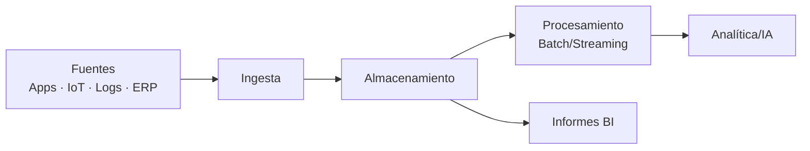
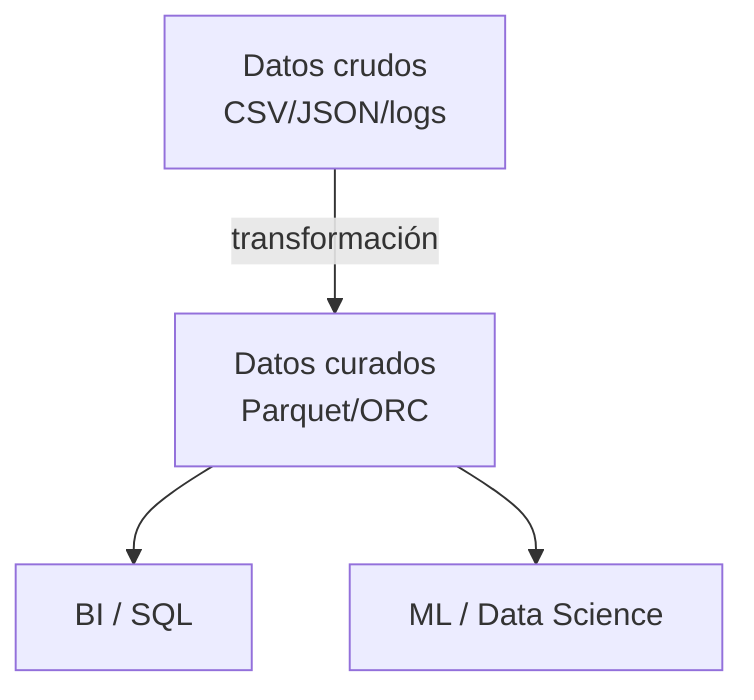
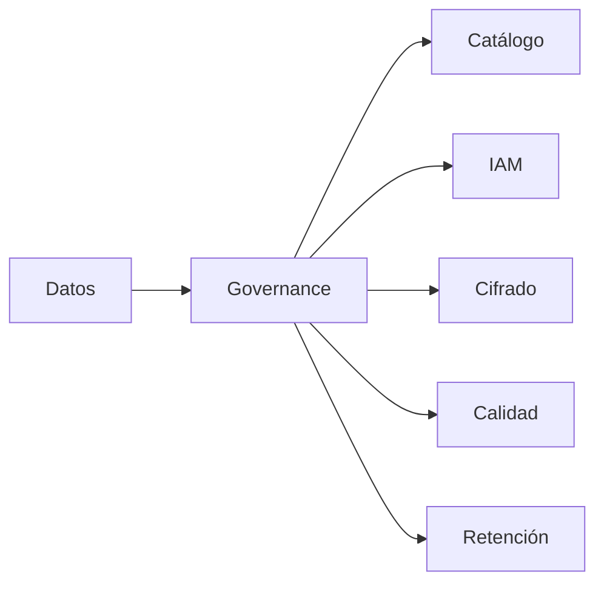

+++
title = "5. Almacenamiento de Big Data en la nube"
weight = 5
+++

El almacenamiento es el cimiento del Big Data. Las soluciones tradicionales, basadas en servidores locales con capacidad limitada, han demostrado ser incapaces de escalar ante las exigencias de volumen y velocidad que imponen las "5 V".

## 5.1. La evolución del almacenamiento: del almacén al lago

Históricamente, las empresas centralizaban su información en el **Data Warehouse** (almacén de datos), un modelo diseñado para datos estructurados y procesados, ideal para generar informes de negocio consistentes pero muy rígido y costoso cuando se trata de información no estructurada. La irrupción del Big Data forzó la aparición del **Data Lake** (lago de datos), un repositorio mucho más flexible y económico que permite almacenar datos crudos en su formato nativo. Mientras que el almacén funciona como una tienda perfectamente ordenada donde todo está etiquetado, el lago actúa como un vasto reservorio de datos en bruto, listos para ser explorados por científicos de datos o utilizados para entrenar inteligencias artificiales.

## 5.2. El rol imprescindible de la nube

La computación en la nube (*cloud computing*) se ha convertido en el habilitador tecnológico por excelencia para este nuevo paradigma. Frente a la inversión inicial masiva en hardware (CAPEX), la nube ofrece un modelo de pago por uso (OPEX) que permite una **escalabilidad elástica**, creciendo o decreciendo en recursos según la demanda del momento. Además, proveedores como AWS, Azure o Google Cloud garantizan la seguridad y la redundancia de la información mediante la replicación geográfica, protegiendo los datos contra fallos físicos o desastres locales de una forma que sería inviable para un centro de datos corporativo tradicional.

## 5.3. Nuevas bases de datos y sistemas distribuidos

Para gestionar la variedad y velocidad extremas, el modelo relacional clásico (SQL) a menudo resulta insuficiente debido a su esquema fijo. Por ello, han proliferado las bases de datos **NoSQL**, que ofrecen esquemas flexibles y un altísimo rendimiento para la lectura y escritura masiva, siendo ideales para documentos, grafos o series temporales. Paralelamente, cuando los conjuntos de datos superan la capacidad de un único equipo, entran en juego los **sistemas de archivos distribuidos** como HDFS (Hadoop). Esta tecnología fragmenta los archivos gigantes en bloques y los reparte entre múltiples nodos de un clúster, permitiendo el procesamiento en paralelo y reduciendo drásticamente los tiempos de análisis.

## Ampliación: almacenamiento de Big Data

Cuando hablamos de Big Data, el reto no es solo “tener datos”, sino **almacenarlos de forma útil**: que puedan consultarse y procesarse cuando haga falta para analítica, IA, informes o alertas. En clase suele verse como “guardar archivos”, pero en un proyecto real el almacenamiento incluye decisiones sobre **dónde** guardo cada tipo de dato, **cómo** lo organizo y **con qué reglas** se accede. Por ejemplo, no es lo mismo guardar el histórico de ventas para un informe mensual que registrar millones de eventos de una web por minuto. En el primer caso prima la consistencia y la facilidad de consulta; en el segundo, la capacidad de ingesta y el coste. Por eso, almacenar Big Data implica pensar en rendimiento, seguridad, calidad y continuidad: si el almacenamiento falla, el resto de la cadena (procesamiento, BI o ciencia de datos) se queda sin “combustible”.

Otro punto clave es que Big Data se caracteriza por las “V”: **volumen** (mucho), **variedad** (diferentes formatos), **velocidad** (datos que llegan rápido) y, muy importante, **veracidad** (calidad). Si no se diseña bien el almacenamiento, aparecen problemas típicos: duplicados, versiones contradictorias (“final_v3”), costes que crecen sin control y análisis poco fiables. Para hacerlo más didáctico, piensa en una biblioteca: no basta con tener muchos libros, hay que catalogarlos, colocarlos en estanterías lógicas y controlar quién puede acceder a ciertos libros. En datos pasa igual: necesitamos organización (particiones), formatos eficientes (para leer rápido) y un ciclo de vida (qué se guarda “caliente” para uso diario y qué se archiva).

En este tema veremos, paso a paso, **qué opciones de almacenamiento existen** y **cuándo conviene cada una**. Primero distinguiremos modelos como **Data Warehouse**, **Data Lake** y **Lakehouse**, porque cada uno responde a necesidades distintas (BI estable vs exploración flexible vs combinación). Después repasaremos tecnologías habituales (almacenamiento de objetos, sistemas distribuidos, NoSQL y formatos columnares) y cómo influyen en coste y rendimiento. Finalmente, trabajaremos buenas prácticas imprescindibles: particionado, separación de datos crudos/curados, catálogo y metadatos, control de accesos y retención/borrado. El objetivo es que puedas justificar decisiones: “elijo X porque mi caso requiere Y”, en lugar de memorizar definiciones sin contexto.

### Mapa mental del tema 5

```mermaid
flowchart TB
    T5[Tema 5
    Almacenamiento Big Data]

    T5 --> R[Requisitos]
    R --> V1[Volumen]
    R --> V2[Variedad]
    R --> V3[Velocidad]
    R --> V4[Veracidad]
    R --> V5[Valor]

    T5 --> M[Modelos]
    M --> DW[Data Warehouse]
    M --> DL[Data Lake]
    M --> LH[Lakehouse]

    T5 --> T[Tecnologías]
    T --> OBJ[Object storage]
    T --> DFS[FS distribuido (ej. HDFS)]
    T --> NOSQL[NoSQL]
    T --> COL[Formatos columnares]

    T5 --> P[Buenas prácticas]
    P --> PART[Particionado]
    P --> META[Catálogo/Metadatos]
    P --> SEC[Seguridad]
    P --> COST[Coste y ciclo de vida]
```

_Vista global: requisitos → modelos de almacenamiento → tecnologías → prácticas._

---

### 5.1. ¿Qué significa “almacenar Big Data”?

Almacenar Big Data significa **preparar un lugar y una forma de guardar datos** para que, después, podamos encontrarlos, entenderlos y analizarlos. No es solo “guardar mucho”, sino guardar de manera que el dato siga siendo útil en el tiempo. Por ejemplo, si guardas millones de registros de sensores IoT sin indicar fecha, dispositivo o ubicación, luego será muy difícil responder preguntas básicas como “¿qué pasó ayer?” o “¿qué dispositivos fallan más?”. Por eso, almacenar bien implica decidir cómo organizar los datos (por ejemplo, por fechas o por centros), cómo documentarlos (metadatos) y cómo asegurar que diferentes equipos no creen copias contradictorias. Dicho de forma sencilla: el almacenamiento es como el “archivo” de una organización, y si ese archivo está desordenado, cualquier análisis será lento, caro o directamente incorrecto.

Además, Big Data aparece cuando se combinan **volumen**, **variedad** y **velocidad**. Volumen: porque el histórico crece y no cabe en un único equipo; variedad: porque no todo viene como tablas “bonitas”, también hay logs, JSON, imágenes o audio; velocidad: porque el dato llega continuamente (streaming) o en cargas grandes (batch). A esto se añade la **veracidad**: si los datos llegan con errores, duplicados o formatos inconsistentes, el almacenamiento no debe “hacer magia”, pero sí debe ayudar a detectar y gestionar el problema. En un entorno real, se espera que el sistema soporte picos, que no se caiga por un fallo de un nodo, y que permita recuperar información sin perderla. Por eso se diseñan almacenes distribuidos, con replicación y controles.

Por último, almacenar Big Data también implica cumplir requisitos que no siempre se ven en una explicación teórica: **seguridad, integridad, disponibilidad y escalabilidad**. Seguridad: que no cualquiera acceda a datos sensibles; integridad: que sepamos si un dato ha sido alterado; disponibilidad: que los datos estén accesibles cuando el negocio lo necesita; escalabilidad: poder crecer sin reconstruir todo desde cero. En la práctica, esto se traduce en cifrado, control de accesos, auditoría, copias y un buen diseño de particiones. Si lo haces bien, el almacenamiento se convierte en una base sólida para BI y ciencia de datos; si lo haces mal, el proyecto se frena por costes, rendimiento o desconfianza en los resultados.



_El almacenamiento es el “centro” que alimenta analítica e informes._

**Conceptos clave:** **escalabilidad**, **integridad**, **disponibilidad**, **coste**, **seguridad**, **metadatos**.

**Caso real (simplificado):** una tienda online guardaba logs en un servidor único. Cuando el tráfico creció, el disco se saturó y los informes dejaron de funcionar. Al mover los logs a almacenamiento escalable y separar “datos crudos” de “datos preparados”, recuperaron estabilidad y mejoraron el tiempo de análisis.

---

### 5.2. Modelos: Data Warehouse, Data Lake y Lakehouse

En Big Data suele hablarse de tres enfoques de almacenamiento: **Data Warehouse**, **Data Lake** y **Lakehouse**. La idea didáctica aquí es entender que no son tres “modas”, sino tres respuestas a una pregunta: **¿para qué quiero usar los datos?** Si tu prioridad es sacar informes repetibles con definiciones estables (ventas, coste, rendimiento), necesitas un entorno muy controlado y rápido. Si tu prioridad es experimentar con datos variados (logs, texto, JSON, imágenes) y aún no sabes qué preguntas harás, necesitas flexibilidad. Y si quieres ambas cosas, aparece el enfoque híbrido. Lo importante no es memorizar nombres, sino relacionarlos con el tipo de uso y con el nivel de control.

Una forma sencilla de visualizarlo es pensar en dos “momentos” del dato: **dato en bruto** (tal como llega) y **dato preparado** (listo para análisis). El warehouse suele trabajar con datos preparados y consistentes, mientras que el lake se siente cómodo con datos en bruto y semi-procesados. El lakehouse intenta que el lago no sea una “caja de archivos” sino un sistema consultable y gobernado, manteniendo costes competitivos. En clase, esto se traduce en un criterio práctico: si tu equipo de negocio necesita cuadros de mando semanales, te interesa un entorno tipo warehouse; si un equipo de datos quiere probar modelos con nuevas fuentes, te interesa un lake.

En la realidad, lo más común es que convivan: un lake para almacenar el histórico y la diversidad, y un warehouse (o capa tipo warehouse) para publicar datasets “oficiales” para BI. El riesgo más conocido es el **data swamp**: un lake sin gobernanza donde hay muchos datos pero nadie sabe cuál es fiable. Por eso, al elegir modelo no solo cuenta la tecnología: cuenta la disciplina de metadatos, control de accesos, calidad y ownership. En el resto del tema verás que casi todo vuelve a la misma idea: sin organización, el valor del dato se pierde.

#### 5.2.1. Data Warehouse (DW)

Un **Data Warehouse** almacena datos **estructurados** y preparados para análisis (limpios y modelados). Es como una “zona oficial” donde las definiciones están claras: qué es una venta, cómo se calcula el margen, qué significa cliente activo. Por eso se usa mucho para **informes** y **KPIs**, porque ofrece consistencia: dos personas distintas deberían obtener el mismo resultado si hacen la misma consulta.

#### 5.2.2. Data Lake (DL)

Un **Data Lake** guarda datos en bruto o semi-procesados (estructurados y no estructurados). Es útil cuando quieres capturar mucho y variado sin decidirlo todo desde el principio. Es especialmente valioso para ciencia de datos y exploración, porque permite volver atrás al dato original si cambian las necesidades o si quieres reconstruir una transformación.

#### 5.2.3. Lakehouse (LH)

El **Lakehouse** intenta combinar lo mejor del lake (flexibilidad y coste) con lo mejor del warehouse (gestión, rendimiento y gobernanza). La idea es poder hacer consultas tipo BI y, a la vez, alimentar proyectos de ML, sin duplicar datos en demasiados sitios. Para lograrlo, se apoya en formatos y tecnologías que permiten consultas eficientes y controladas sobre el lago.

#### Tabla comparativa — DW vs DL vs LH

| Modelo | Tipo de datos | Punto fuerte | Limitación típica | Uso típico |
|---|---|---|---|---|
| Data Warehouse | Estructurados y modelados | Rendimiento y consistencia para BI | Menos flexible; requiere modelado | Informes, cuadros de mando |
| Data Lake | Casi cualquier formato | Flexibilidad y coste | Riesgo de “data swamp” sin gobernanza | Exploración, ML, históricos |
| Lakehouse | Mixto (sobre lake) | Flexibilidad + consultas | Requiere buena disciplina técnica | BI + ML sobre un mismo lago |

**Conceptos clave:** **DW**, **DL**, **lakehouse**, **data swamp**, **ETL/ELT**, **gobernanza**.

---

### 5.3. Tecnologías de almacenamiento (visión práctica)

Una vez entendido el “modelo” (DW, DL o lakehouse), toca aterrizarlo en tecnología. En la práctica, el almacenamiento Big Data se construye como un **ecosistema**: no suele haber una única herramienta que lo haga todo. Se combinan servicios o sistemas para guardar datos en bruto, transformar a formatos más eficientes, servir consultas, y mantener metadatos y seguridad. Esto explica por qué, al leer sobre Big Data, aparecen muchos nombres: cada pieza resuelve una parte del problema.

Para que sea más didáctico, piensa en un flujo típico: llegan datos (logs, ERP, sensores), se depositan en una “zona de aterrizaje” barata y escalable, se transforman y se publican en una “zona curada” lista para consultas rápidas. En ese camino entran decisiones como: ¿uso almacenamiento de objetos en la nube o un sistema distribuido en local?, ¿necesito una base NoSQL para consultas en tiempo real?, ¿qué formato me permite reducir tamaño y acelerar lecturas? La respuesta correcta depende del caso de uso, del presupuesto y de las habilidades del equipo.

Además, hay un criterio transversal que no se debe olvidar: **el coste total** no es solo “cuánto ocupa”. También cuentan las lecturas, las transferencias, la replicación, el mantenimiento y el tiempo del equipo. Por eso, elegir tecnología es equilibrar rendimiento, coste y complejidad. En las secciones siguientes verás las piezas más comunes y para qué se usan.

#### 5.3.1. Almacenamiento de objetos (Object Storage)

El **almacenamiento de objetos** es el modelo típico en la nube (y también puede existir on‑prem). La idea es guardar datos como “objetos” en contenedores llamados “buckets”. Es especialmente útil para **datos en bruto**, históricos y ficheros grandes (logs, exports, multimedia), porque escala con facilidad: si mañana duplicas el volumen, no tienes que “comprar un disco más grande”, sino que el sistema distribuye y gestiona el crecimiento.

Desde el punto de vista didáctico, su gran ventaja es el **coste** y la **simplicidad de almacenamiento**: guardar es fácil y relativamente barato. El punto delicado aparece cuando quieres consultar: si guardas millones de JSON pequeños, leerlos uno a uno puede ser lento. Por eso se suele combinar con una fase de curación (por ejemplo, convertir a formatos columnares) y con motores de consulta.

En resumen: object storage es una base excelente para un data lake, pero hay que diseñar encima la parte de rendimiento (formatos, particiones y catálogos). Si lo entiendes así, verás por qué se menciona tanto en arquitecturas modernas.

Un detalle práctico que suele marcar la diferencia es **cómo escribes** en ese object storage: conviene agrupar por periodos (por ejemplo, “eventos por día”), evitar millones de ficheros diminutos y definir una convención de nombres y carpetas que refleje particiones. Por ejemplo, un esquema `eventos/año=2026/mes=01/dia=19/` permite localizar y borrar/archivar rangos fácilmente. También es habitual aplicar “clases” o niveles de almacenamiento (caliente/frío) para bajar costes en históricos: el dato reciente se consulta mucho y el histórico se guarda más barato. La lección didáctica es que el almacenamiento de objetos es simple, pero para que sea eficiente hay que pensar en organización y ciclo de vida.

#### 5.3.2. Sistemas de ficheros distribuidos (DFS)

Un **sistema de ficheros distribuido (DFS)** reparte archivos en varios nodos y suele incluir replicación y tolerancia a fallos. El ejemplo clásico es HDFS, muy ligado al ecosistema Hadoop. Su lógica es “dividir y repartir”: en lugar de tener un archivo enorme en un solo servidor, se parte en bloques y se guarda en varios equipos, de forma que si uno falla no se pierde el dato.

Didácticamente, su punto fuerte aparece cuando el **procesamiento** ocurre “cerca” del almacenamiento: mueves el cálculo hacia donde está el dato, en vez de mover grandes cantidades de dato por la red. Este enfoque fue clave cuando el almacenamiento en la nube no era tan común o cuando se trabaja en centros de datos propios.

Hoy en día, en muchos entornos cloud se usa más object storage, pero los conceptos del DFS siguen siendo útiles: distribución, replicación, tolerancia a fallos y escalado horizontal. Entender DFS te ayuda a entender por qué Big Data no depende de un único servidor.

En proyectos reales, el DFS también te enseña algo importante: cuando usas almacenamiento distribuido, necesitas **operación** (monitorización, capacidad, reemplazo de nodos, permisos). Es decir, no es solo tecnología, es gestión. Por eso algunos equipos prefieren soluciones gestionadas en la nube, y otros mantienen DFS on‑prem por requisitos (datos sensibles, latencia, dependencia de proveedor). Didácticamente, conviene que te quedes con la idea de “horizontalizar”: en Big Data se crece añadiendo nodos, no comprando un “super-servidor”. Ese cambio de mentalidad es la base de muchas arquitecturas modernas.

#### 5.3.3. Bases de datos NoSQL

Las bases de datos **NoSQL** se usan cuando el modelo relacional no encaja bien o cuando se prioriza escalabilidad y flexibilidad. La idea clave es que NoSQL no significa “sin estructura”, sino “estructura adaptada al caso”. Por ejemplo, si tus datos cambian de forma con frecuencia (campos nuevos, estructuras variables), un modelo documental (tipo JSON) suele ser más natural que una tabla rígida.

También aparecen en escenarios de alto rendimiento: un sistema clave‑valor permite lecturas/escrituras muy rápidas por identificador; un almacén columnar distribuido es útil para eventos y series temporales; y una base de grafos destaca cuando lo importante son las relaciones (quién conoce a quién, qué transacciones se conectan, rutas entre nodos). La parte didáctica aquí es elegir por pregunta: ¿mi consulta es “dame el objeto por id”? ¿o “agrupa millones de eventos”? ¿o “encuentra patrones de relación”?.

En Big Data, NoSQL suele convivir con lakes/warehouses: NoSQL para operación o acceso rápido, y el lago/warehouse para analítica e histórico. Entender esa convivencia evita el error de intentar usar una sola tecnología para todo.

Un punto didáctico muy útil es recordar que NoSQL suele requerir **diseñar pensando en la consulta**, no en “normalizar” como en SQL. A menudo se duplican datos (denormalización) para responder rápido a preguntas concretas. Esto mejora rendimiento, pero exige control: si duplicas, necesitas reglas para mantener coherencia. Además, algunas bases NoSQL priorizan disponibilidad y admiten consistencia eventual, lo que puede ser aceptable en analítica o catálogos, pero no siempre en transacciones críticas. La clave es preguntar: ¿qué tolera mi caso de uso: latencia, inconsistencia temporal, o complejidad de mantenimiento?

#### Tabla comparativa — tipos NoSQL

| Tipo | Qué modela bien | Ejemplo de uso |
|---|---|---|
| Documentos | entidades con campos variables | perfiles de usuario, catálogos |
| Clave-valor | lecturas/escrituras simples | sesiones, cachés |
| Columnar | tablas enormes distribuidas | eventos, series temporales |
| Grafos | relaciones y caminos | recomendaciones, fraude |

#### 5.3.4. Formatos de datos eficientes (columnares)

Para analítica, un truco muy importante es **cómo guardas el fichero**. En vez de guardar “fila a fila” como un CSV, los formatos columnares (por ejemplo, **Parquet** u **ORC**) guardan “columna a columna”. Esto es muy eficiente cuando haces consultas que solo necesitan algunas columnas (por ejemplo, fecha, importe y país): el motor puede leer únicamente esas columnas y saltarse el resto.

En términos didácticos, imagina una hoja de cálculo enorme. Si te interesa solo una columna, sería absurdo cargarla entera con todas las columnas; un formato columnar se comporta como si pudieras abrir solo lo necesario. Además, estos formatos suelen comprimir muy bien porque los valores de una misma columna se parecen entre sí (muchas fechas, muchos códigos repetidos), lo que reduce espacio y coste.

Por eso, una buena práctica típica es: guardar el dato crudo (por trazabilidad) y, en paralelo, generar una versión curada en formato columnar, particionada por fecha. Esa combinación suele ser la base de sistemas de BI rápidos sobre un data lake.

Un error típico es pensar que “con Parquet ya está”: si generas muchísimos archivos pequeños, el motor pierde tiempo abriéndolos y gestionando metadatos. Por eso, además del formato, importa el **tamaño de fichero** y la organización (particiones). La explicación didáctica es sencilla: un motor analítico no solo lee datos, también “coordina” lecturas; demasiados fragmentos aumentan la sobrecarga. Por eso se suelen compactar ficheros y se recomiendan estrategias de escritura por lotes. Si entiendes esto, te será fácil justificar por qué la curación no es solo convertir CSV→Parquet, sino preparar el dataset para consultas reales.



_Separar crudo vs curado mejora rendimiento y control._

**Conceptos clave:** **object storage**, **DFS**, **NoSQL**, **formatos columnares**, **curación de datos**.

---

### 5.4. Diseño del almacenamiento: particionado, replicación y rendimiento

Un error común es “guardar todo junto” sin estrategia. En Big Data, el diseño del almacenamiento determina si las consultas serán rápidas o si el sistema se volverá lento y caro. La razón es simple: cuando trabajas con millones o miles de millones de registros, ya no puedes permitirte “leerlo todo para responder una pregunta pequeña”. Necesitas estructuras que reduzcan el trabajo: particionar, elegir formatos adecuados y planificar replicación.

La idea didáctica es pensar siempre en el patrón de uso: ¿consultaré por fechas? ¿por centros? ¿por producto? Si lo sabes, puedes organizar el almacenamiento para que el motor lea solo una parte del dato. Por ejemplo, si casi todas las consultas piden “último mes”, particionar por fecha reduce muchísimo el volumen leído. Además, el diseño influye en la ingesta: es más fácil añadir datos a particiones nuevas que reescribir un fichero gigante.

Por último, en sistemas distribuidos aparece el equilibrio entre rendimiento y resiliencia. Replicar datos hace el sistema más robusto, pero también aumenta coste. Y hay casos donde se prioriza consistencia (por ejemplo, operaciones financieras) y otros donde se prioriza disponibilidad (analítica). Entender estos compromisos te ayuda a justificar decisiones técnicas con lógica de negocio.

#### 5.4.1. Particionado

El **particionado** consiste en dividir un conjunto de datos en partes (por ejemplo, por fecha, país, centro o curso). La clave está en que el particionado debe alinearse con las preguntas habituales. Si casi siempre filtras por fecha, particionar por `año/mes/día` es una gran idea porque permite al motor “saltar” particiones que no necesita.

Esto se traduce en dos beneficios directos: consultas más rápidas (se lee menos) y cargas más simples (añades particiones nuevas). También facilita gestión del ciclo de vida: puedes archivar o borrar particiones antiguas sin tocar el resto.

Como regla práctica, conviene evitar particiones demasiado finas (millones de carpetas) o demasiado gruesas (una sola carpeta gigante). En clase, un buen ejercicio es elegir un dataset (por ejemplo, registros de asistencia) y proponer dos esquemas de particionado, justificando cuál optimiza mejor las consultas típicas.

Otra buena idea didáctica es fijarse en la **cardinalidad** (cuántos valores distintos) de la columna usada para particionar. Particionar por un campo con muchísimos valores (por ejemplo, “id_usuario”) puede crear miles de particiones pequeñas y empeorar el rendimiento. En cambio, fecha suele ser una partición natural porque agrupa bien y coincide con la mayoría de filtros. Si necesitas afinar más, se pueden añadir técnicas complementarias (como “ordenar” o “agrupar” dentro de la partición) para acelerar sin multiplicar carpetas. La lección es: particiona por lo que filtras a menudo, pero sin crear fragmentación extrema.

#### 5.4.2. Replicación y tolerancia a fallos

En sistemas distribuidos, la **replicación** se usa para resistir fallos: si un nodo cae, hay otra copia disponible. Esto mejora disponibilidad y reduce el riesgo de pérdida por fallos de hardware. En Big Data, donde un único servidor no basta, la tolerancia a fallos no es un “extra”: es parte del diseño.

Didácticamente, piensa en la diferencia entre guardar un trabajo en un USB (una copia) y guardarlo también en la nube y en el ordenador (varias copias). Si pierdes el USB, no lo pierdes todo. En sistemas Big Data la idea es similar, pero automatizada.

El coste de la replicación es que ocupa más espacio. Por eso se eligen niveles de replicación según criticidad: no todo necesita el mismo nivel. Y además, se combina con copias de seguridad y políticas de recuperación, porque replicación no sustituye a un backup.

Aquí es clave no confundir **replicación** con **backup**. La replicación protege contra fallos de hardware y mejora disponibilidad, pero si borras datos por error o un proceso escribe datos corruptos, esa corrupción puede replicarse. El backup, en cambio, te permite volver atrás en el tiempo (punto de recuperación). Por eso, una arquitectura madura combina ambos: replicación para continuidad y backups/versionado para recuperación. Didácticamente, puedes pensar en “seguir funcionando” (replicación) vs “poder deshacer un desastre” (backup).

#### 5.4.3. Consistencia vs disponibilidad (idea básica)

En entornos distribuidos, a veces hay compromisos entre **consistencia** y **disponibilidad**. Consistencia significa que todos ven el mismo dato inmediatamente; disponibilidad significa que el sistema responde incluso si hay fallos parciales. Cuando hay cortes de red o nodos caídos, algunos sistemas priorizan seguir funcionando aunque el dato tarde un poco en propagarse.

Lo didáctico aquí es no absolutizar: para pagos o inventario, la consistencia suele ser crítica; para analítica, a veces puedes aceptar cierta latencia (por ejemplo, que un dashboard se actualice cada pocos minutos). Por eso la elección depende del impacto de “ver un dato antiguo” frente al impacto de “no poder consultar nada”.

Si entiendes este concepto, entenderás por qué algunas tecnologías de Big Data se describen como “eventualmente consistentes” y por qué se diseñan pipelines donde el dato se consolida por etapas. La lección: define primero el requisito del negocio, y luego elige el comportamiento del sistema.

En la práctica, para convivir con estos compromisos se aplican patrones sencillos: por ejemplo, publicar datos en una zona “staging” y solo mover a “curado” cuando pasan validaciones; usar marcas de agua (watermarks) en streaming para saber hasta qué instante el dato es completo; o diseñar dashboards que indiquen la hora de última actualización. Eso no “soluciona” la teoría, pero sí crea expectativas correctas y evita decisiones erróneas basadas en datos incompletos. La idea didáctica es que consistencia/disponibilidad no es un debate abstracto: se traduce en cómo comunicamos y controlamos la frescura del dato.

**Conceptos clave:** **particionado**, **replicación**, **tolerancia a fallos**, **consistencia**, **disponibilidad**.

---

### 5.5. Gobernanza y seguridad del almacenamiento

La **gobernanza** es lo que convierte un almacén de datos en un sistema útil y confiable. Sin gobernanza, un data lake puede degradarse a “data swamp”: hay muchos datos, pero nadie sabe cuáles son correctos, actuales o autorizados. En un proyecto real, este punto es crítico porque afecta a la confianza: si negocio no confía en los datos, dejará de usar los informes y el proyecto pierde valor.

De forma didáctica, la gobernanza responde a preguntas muy humanas: ¿qué datos existen?, ¿qué significan?, ¿quién los mantiene?, ¿qué versión es la “oficial”?, ¿quién puede acceder? Para responder, se usan catálogos, diccionarios y metadatos, además de reglas de calidad. El **linaje (lineage)** es especialmente importante: permite explicar de dónde sale un número (por ejemplo, una métrica del dashboard) y qué transformaciones ha sufrido. Eso reduce discusiones y acelera auditorías.

La seguridad, además, debe ir integrada: control de acceso (IAM) con mínimo privilegio, cifrado en reposo y tránsito, y registros de auditoría. Y no olvides el ciclo de vida: retención, archivado y borrado según normativa. En resumen, gobernanza y seguridad no son burocracia: son la base para que el dato sea utilizable, trazable y defendible.



**Conceptos clave:** **gobernanza**, **catálogo**, **lineage**, **IAM**, **cifrado**, **retención**.

**Caso real (simplificado):** un equipo subió múltiples versiones de un dataset (“clientes_final”, “clientes_final2”…). Nadie sabía cuál era la buena. Al implantar catálogo + ownership + reglas de calidad, las consultas volvieron a ser fiables.

---

### 5.6. Buenas prácticas (checklist)

Esta sección resume el “qué haría yo” si tuviera que montar un almacenamiento de Big Data de forma ordenada. La idea no es memorizar una lista, sino entender que las buenas prácticas son **respuestas a problemas típicos**: lentitud al consultar, costes que se disparan, confusión sobre versiones y riesgo de accesos indebidos. Si aplicas estas prácticas desde el inicio, evitas rehacer el sistema cuando el volumen crece.

Primero, separa **dato crudo** (tal como llega) y **dato curado** (limpio, validado y optimizado). Esto te da trazabilidad y, a la vez, rendimiento. Segundo, diseña particiones con sentido (normalmente fecha + un criterio funcional) para que las consultas lean solo lo necesario. Tercero, usa formatos eficientes para analítica (columnares cuando aplique) para reducir espacio y acelerar consultas. Estas tres decisiones, juntas, suelen dar el mayor impacto técnico con poco coste conceptual.

Finalmente, refuerza el lado organizativo: define ownership (quién es dueño de cada dataset y cómo se valida), controla costes (almacenamiento, lecturas, transferencias) y aplica seguridad por defecto (mínimo privilegio + cifrado + auditoría). La clave didáctica es esta: Big Data funciona cuando tecnología y organización están alineadas; si falta una de las dos, el sistema se vuelve caro o inútil.

1. Guardar **crudo** y **curado** por separado.
2. Elegir particiones con sentido (normalmente fecha y un segundo criterio).
3. Usar formatos eficientes para analítica (columnares cuando aplique).
4. Definir **quién es el dueño del dato** (data owner) y cómo se valida.
5. Medir y controlar costes (almacenamiento, lecturas, transferencias).
6. Aplicar seguridad desde el diseño (mínimo privilegio + cifrado).

#### Tabla resumen — qué elegir según necesidad

| Necesidad | Opción típica | Motivo |
|---|---|---|
| Informes corporativos estables | Data Warehouse | rendimiento y consistencia |
| Datos variados y exploración | Data Lake | flexibilidad y coste |
| BI + ML en un mismo entorno | Lakehouse | unificación + gobernanza |
| Lecturas rápidas por clave | Clave-valor | baja latencia |
| Relaciones complejas | Grafos | consultas por relaciones |

---

### Resumen del tema 5

- El almacenamiento en Big Data debe ser escalable, seguro y gobernado.
- DW, DL y Lakehouse se eligen por tipo de dato y uso (BI vs exploración vs mixto).
- Particionado + formatos eficientes mejoran rendimiento y costes.
- La gobernanza (catálogo, IAM, lineage, calidad) evita el “data swamp”.

### Comprueba que lo has entendido

1. Explica la diferencia entre **Data Warehouse** y **Data Lake** con un ejemplo.
2. ¿Qué es el **particionado** y por qué acelera consultas?
3. Cita tres controles de **gobernanza/seguridad** para un lago de datos.
