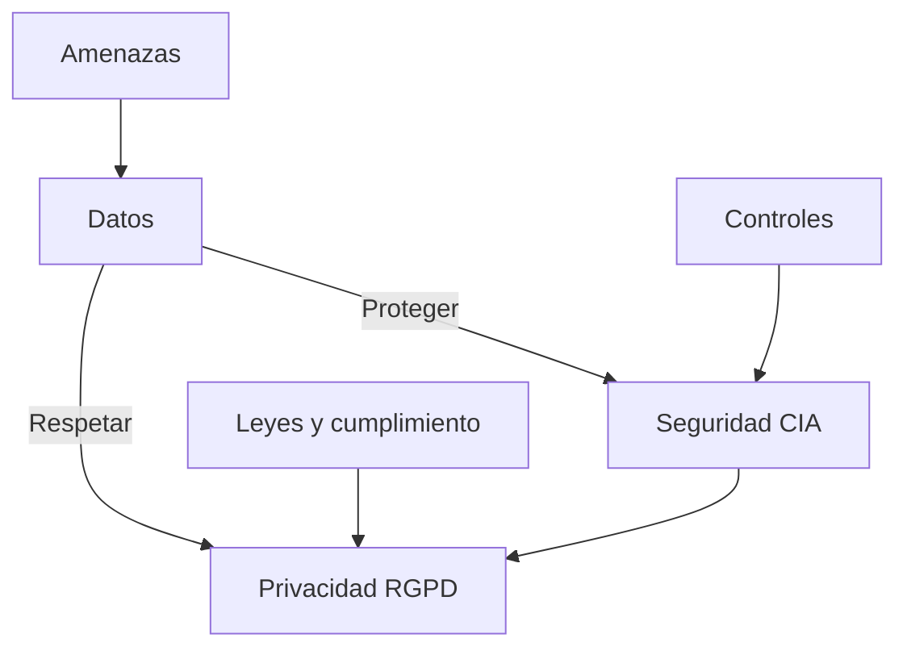
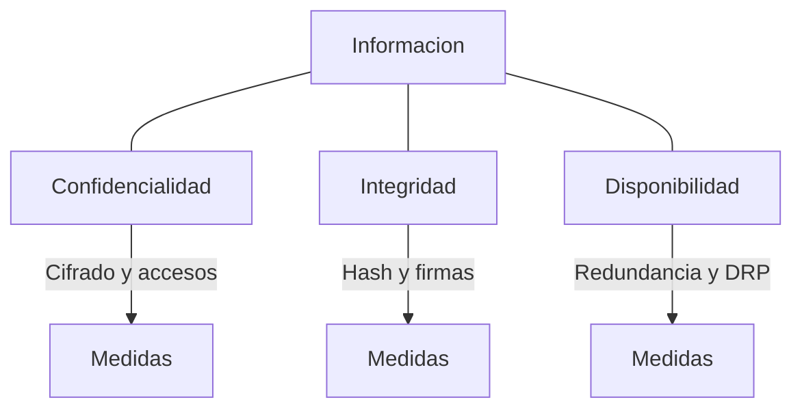
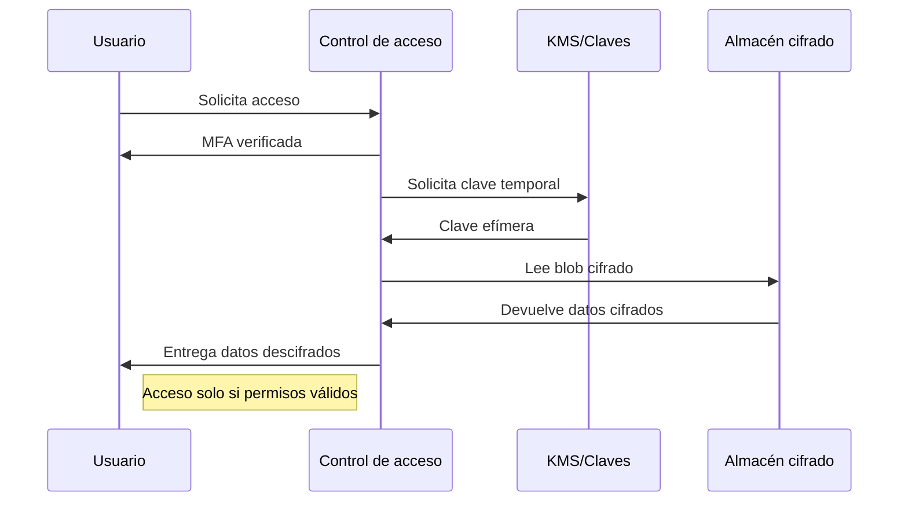
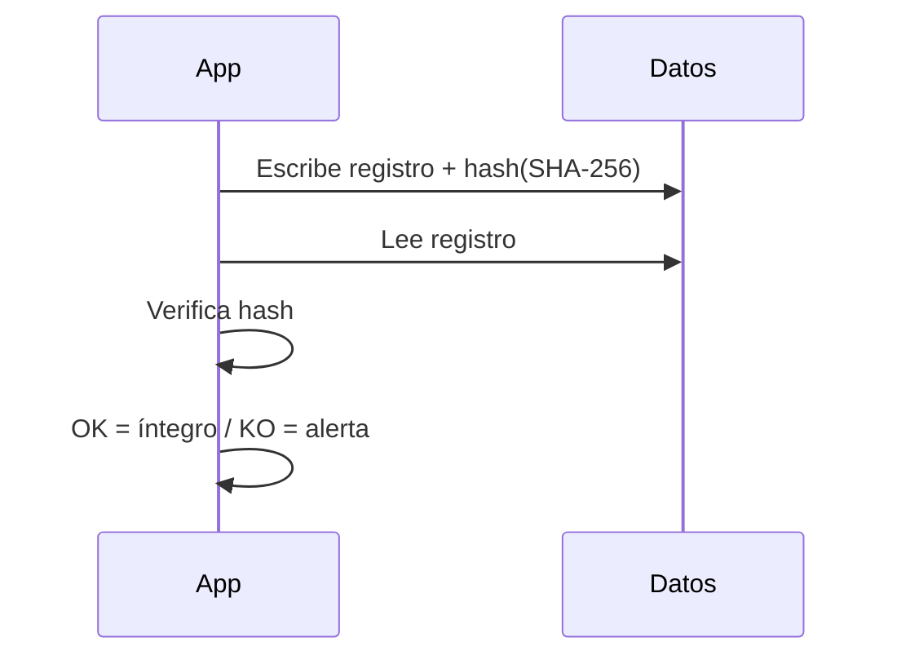
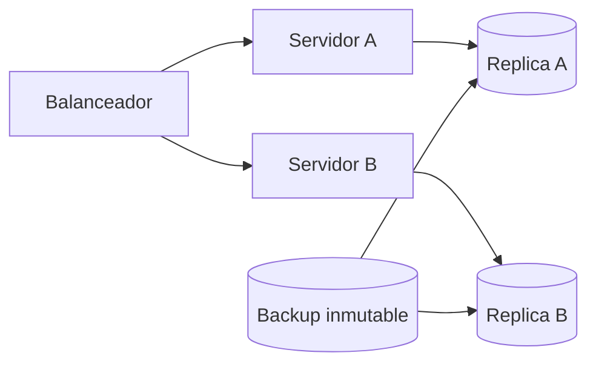
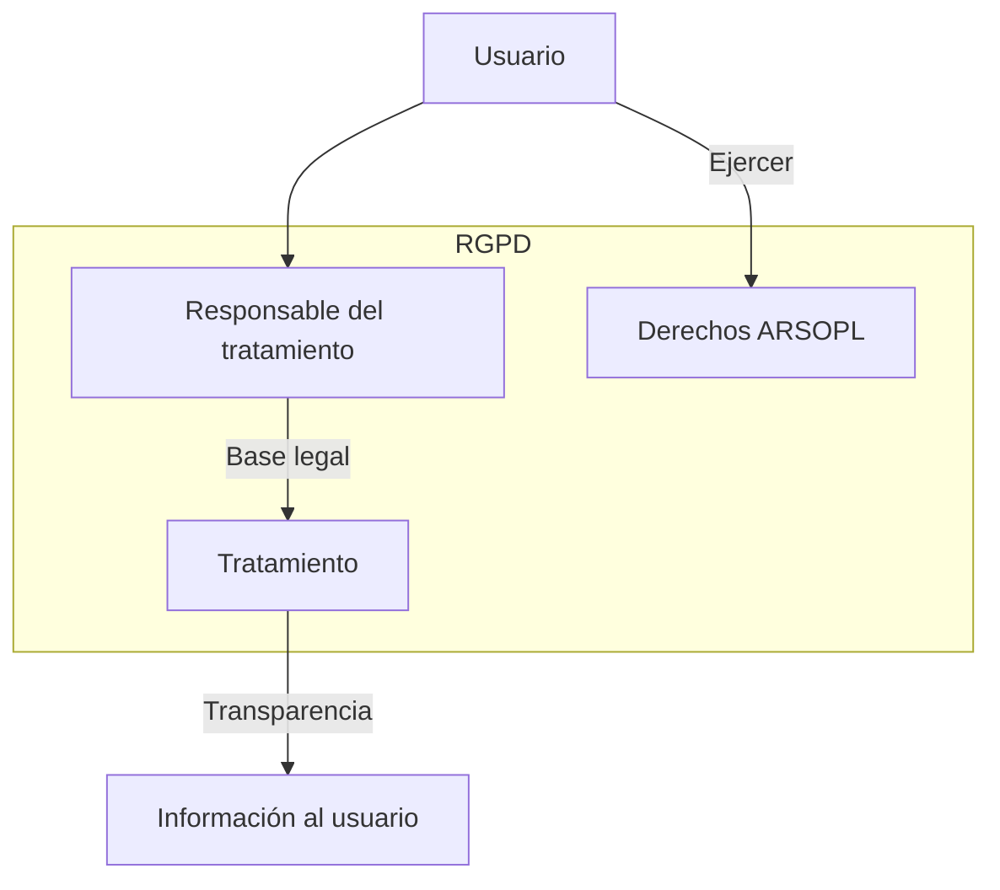
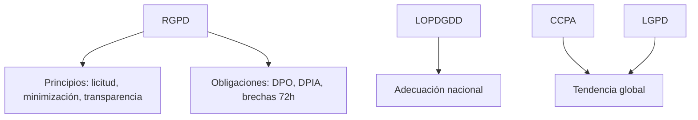
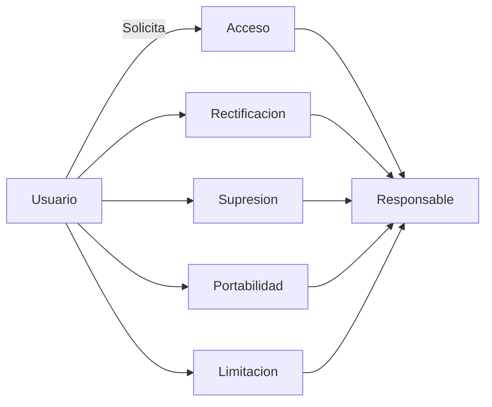
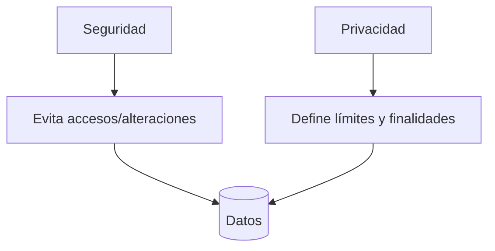
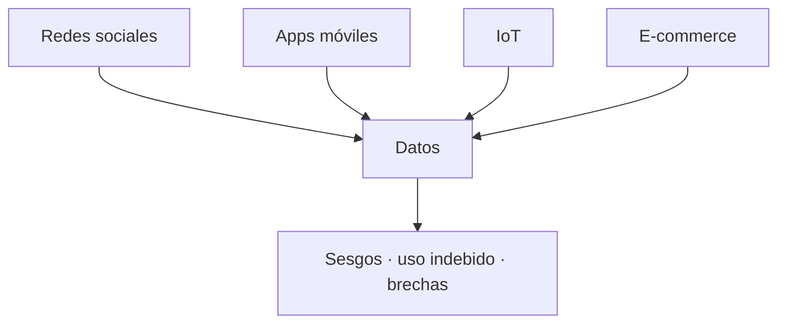

+++
title = "1. Seguridad y Privacidad de la Información"
weight = 1
+++

## 1.1. Seguridad y privacidad en el entorno digital actual

_Relación entre datos, seguridad (CIA), privacidad (RGPD), amenazas y controles._

En la sociedad contemporánea, la información se ha consolidado como uno de los activos estratégicos más valiosos tanto para individuos como para organizaciones. La progresiva digitalización de la economía, la administración pública y la vida cotidiana ha transformado la manera en que se producen, almacenan, transmiten y consumen datos. Hoy en día, procesos tan sensibles como la gestión financiera, la historia clínica electrónica, las transacciones de comercio electrónico o el control de infraestructuras críticas dependen de sistemas informáticos interconectados.

La llamada “sociedad de la información” se caracteriza por una creciente interdependencia tecnológica: cada vez más actividades requieren de plataformas digitales, y estas a su vez generan grandes volúmenes de datos que circulan a través de redes de comunicación. Este fenómeno, conocido como “economía del dato”, ha convertido a la información en un recurso equiparable al capital o la energía.

Sin embargo, este desarrollo acarrea también una exposición creciente a riesgos y amenazas. La ciberseguridad y la privacidad se sitúan en el centro del debate académico, empresarial y político por varias razones:

- Incremento de amenazas externas e internas: ataques de ransomware, robo de identidad, filtraciones de datos, fraudes financieros, ataques de denegación de servicio (DDoS).
- Cibercrimen organizado: grupos con alta capacidad técnica y motivación económica operan a nivel internacional, comercializando datos robados en la “dark web” y desarrollando malware sofisticado.
- Geopolítica del ciberespacio: los Estados utilizan herramientas de ciberespionaje y ciberdefensa como instrumentos estratégicos, lo que añade complejidad al panorama de la seguridad.
- Expansión del IoT (Internet of Things): miles de millones de dispositivos conectados (cámaras, sensores, wearables) generan datos continuamente, ampliando la superficie de ataque.

En este contexto, la seguridad y la privacidad de la información constituyen pilares esenciales para:

1. Proteger los activos críticos: desde bases de datos corporativas y patentes industriales hasta credenciales individuales y comunicaciones privadas.
2. Garantizar la continuidad operativa: un fallo de seguridad puede paralizar hospitales, empresas de transporte o redes eléctricas, con graves consecuencias sociales y económicas.
3. Cumplir con la legislación vigente: en Europa, el Reglamento General de Protección de Datos (RGPD) impone obligaciones estrictas en el manejo de información personal.
4. Preservar la confianza social: la reputación de una organización depende de su capacidad de proteger y gestionar responsablemente los datos de clientes, usuarios y empleados.

Conceptos clave: **seguridad de la información**, **privacidad**, **cibercrimen organizado**, **IoT**, **RGPD**, **continuidad operativa**.

Caso real: durante la pandemia, varios hospitales sufrieron ataques de ransomware que interrumpieron servicios críticos; los centros con planes de continuidad y copias de seguridad robustas pudieron recuperarse rápidamente, mientras que otros vieron afectada su capacidad asistencial.

## 1.2. La seguridad de la información

_Triada CIA aplicada a la información y ejemplos de controles._

La seguridad de la información se define como el conjunto de medidas técnicas, organizativas, físicas y administrativas diseñadas para proteger la información y los sistemas que la procesan frente a amenazas intencionadas (ataques) o accidentales (fallos humanos, errores técnicos, desastres naturales).

Su núcleo conceptual descansa en la triada CIA:

### 1.2.1. Confidencialidad

_Flujo de acceso confidencial con MFA, gestión de claves y cifrado._

- Garantiza que los datos solo puedan ser accedidos por personas o sistemas autorizados. La confidencialidad se logra mediante:
- Cifrado de la información (AES, RSA).
- Controles de acceso (contraseñas robustas, autenticación multifactor, biometría).
- Redes seguras (VPN, firewalls, segmentación de redes).

Conceptos clave: **confidencialidad**, **cifrado**, **controles de acceso**, **VPN**, **firewall**.

Caso real: una empresa evitó la filtración de nóminas porque los archivos estaban cifrados con AES-256; aunque un atacante exfiltró copias, los datos permanecieron ilegibles sin la clave.

### 1.2.2. Integridad

_Verificación de integridad mediante funciones hash y auditoría._

- Asegura que la información se mantenga completa, exacta y no se modifique sin autorización. Ejemplos de mecanismos de integridad:
- Funciones hash criptográficas (SHA-256).
- Firmas digitales.
- Registros de auditoría que permiten verificar cambios.

Conceptos clave: **integridad**, **hash**, **firmas digitales**, **auditoría**.

Caso real: en un proceso judicial, los registros de auditoría y las huellas SHA-256 de documentos electrónicos permitieron demostrar que no habían sido alterados desde su emisión.

### 1.2.3. Disponibilidad

_Alta disponibilidad con balanceo, réplicas y copias inmutables._

- Implica que los datos y servicios estén accesibles cuando los usuarios legítimos los necesiten. La disponibilidad se garantiza mediante:
- Sistemas redundantes (RAID, servidores espejo).
- Planes de recuperación ante desastres (DRP).
- Copias de seguridad periódicas.
- Protección frente a ataques DDoS.

Conceptos clave: **disponibilidad**, **redundancia**, **DRP**, **copias de seguridad**, **DDoS**.

Caso real: una plataforma de aprendizaje online soportó un pico de tráfico malicioso gracias a un CDN con mitigación DDoS y a infraestructura redundante en múltiples zonas.

Además de la triada CIA, hoy en día se añaden otros principios relevantes como la trazabilidad (poder rastrear todas las acciones realizadas sobre los datos), la resiliencia (capacidad de recuperación rápida tras un ataque) y la responsabilidad proactiva (anticiparse a riesgos, no solo reaccionar a incidentes).

La seguridad de la información se materializa a través de:

- Normas y estándares internacionales:
  - ISO/IEC 27001: sistemas de gestión de seguridad de la información.
  - NIST Cybersecurity Framework: marco de referencia en EE. UU. basado en identificar, proteger, detectar, responder y recuperar.
- Modelos de madurez en ciberseguridad: permiten a las organizaciones evaluar su nivel de protección y establecer planes de mejora.
- Centros de Operaciones de Seguridad (SOC): monitorizan en tiempo real las amenazas y gestionan incidentes.

La relevancia práctica de la seguridad de la información se observa en la cifra creciente de ciberataques. Informes como el de Check Point (2023) señalan un aumento anual del 38% en el número de ataques a empresas, lo que refleja la necesidad urgente de integrar la seguridad como parte central de la estrategia corporativa.

## 1.3. La privacidad de la información

_Privacidad: base legal, transparencia y ejercicio de derechos._

La privacidad de la información se refiere al derecho de las personas a decidir cómo se recopilan, procesan, almacenan y comparten sus datos personales. A diferencia de la seguridad, que protege los datos frente a amenazas externas, la privacidad se centra en respetar la voluntad del titular y los límites impuestos por la legislación.

### 1.3.1. Marco legal

_Marco normativo: RGPD y leyes afines y sus pilares._

La privacidad está regulada por diferentes normas internacionales:

- Reglamento General de Protección de Datos (RGPD, UE, 2018): establece principios como licitud, lealtad, transparencia, minimización de datos y responsabilidad proactiva. Introduce obligaciones para las organizaciones (notificación de brechas, nombramiento de Delegados de Protección de Datos).
- LOPDGDD (España, 2018): adapta el RGPD al ordenamiento jurídico nacional.
- CCPA (California Consumer Privacy Act) y LGPD (Lei Geral de Proteção de Dados, Brasil): reflejan una tendencia global hacia la protección de datos.

Conceptos clave: **RGPD**, **LOPDGDD**, **CCPA**, **LGPD**, **responsabilidad proactiva**.

Caso real: la AEPD sancionó a una entidad por instalar cookies no esenciales sin consentimiento informado, vulnerando el principio de transparencia del RGPD.

### 1.3.2. Derechos de los individuos

_Derechos clave del interesado y su tramitación._

El RGPD reconoce derechos fundamentales, entre ellos:

- Acceso: conocer qué datos personales se poseen y cómo se utilizan.
- Rectificación: corregir información inexacta.
- Supresión (“derecho al olvido”): solicitar la eliminación de datos cuando ya no sean necesarios.
- Portabilidad: trasladar los datos a otro proveedor de servicios.
- Limitación del tratamiento: restringir temporalmente el uso de los datos.

Conceptos clave: **acceso**, **rectificación**, **supresión (derecho al olvido)**, **portabilidad**, **limitación del tratamiento**.

Caso real: un usuario ejerció el derecho al olvido para que buscadores retiraran resultados con información obsoleta que afectaba a su reputación profesional.

### 1.3.3. Diferencias entre seguridad y privacidad

_Seguridad y privacidad: enfoques complementarios sobre los datos._

- Seguridad: busca evitar accesos no autorizados, proteger datos frente a amenazas y garantizar su disponibilidad.
- Privacidad: garantiza que los datos se recojan y usen solo con fines legítimos y autorizados.

En síntesis: puede haber seguridad sin privacidad, pero no privacidad sin seguridad.

Conceptos clave: **seguridad**, **privacidad**, **finalidad legítima**, **minimización de datos**.

Caso real: una app con fuerte cifrado (seguridad) compartía datos de uso con terceros para publicidad sin informar adecuadamente (falta de privacidad), generando sanciones y pérdida de confianza.

### 1.3.4. Relevancia en la era digital

_Generación masiva de datos y riesgos asociados en la era digital._

La privacidad adquiere un papel crucial en un mundo en el que cada interacción digital genera datos:

- Redes sociales: se comparten voluntariamente grandes cantidades de información personal.
- Aplicaciones móviles: recopilan datos de ubicación, hábitos de consumo y preferencias.
- Comercio electrónico: requiere datos financieros y patrones de compra.
- Dispositivos IoT: relojes inteligentes, altavoces conectados y sensores recopilan datos de salud, voz o actividad diaria.

El uso indebido de estos datos puede derivar en:

- Vulneraciones de derechos fundamentales.
- Discriminación algorítmica (ej. rechazos de créditos basados en perfiles de datos).
- Pérdida de confianza en instituciones y empresas.

Por todo ello, la privacidad de la información no es solo un requisito legal, sino también un imperativo ético y social en la sociedad digital.

Conceptos clave: **redes sociales**, **apps móviles**, **e-commerce**, **IoT**, **discriminación algorítmica**.

Caso real: datos de actividad física de wearables compartidos con aseguradoras se usaron para ajustar primas, generando debate sobre sesgos y consentimiento explícito.

### Tabla comparativa — Sección 1

| Aspecto | Qué protege | Objetivo | Medidas típicas | Métricas/indicadores |
|---|---|---|---|---|
| Seguridad | Sistemas y datos | Evitar accesos/alteraciones no autorizadas | Cifrado, control de accesos, firewalls, EDR | Incidentes/mes, MTTD/MTTR |
| Privacidad | Datos personales | Respetar derechos y finalidades legítimas | Minimización, transparencia, base legal, DPIA | Solicitudes de derechos atendidas, brechas notificadas |
| Cumplimiento | Obligaciones legales | Demostrar diligencia y conformidad | Políticas, auditorías, registros, formación | Hallazgos de auditoría, niveles de madurez |

### Ejemplos reales

- Filtración en hotelería: exposición de datos de huéspedes impulsó revisiones de privacidad y notificaciones a reguladores.
- Campaña de smishing bancario: clientes engañados para entregar códigos; la MFA redujo el impacto.
- Exfiltración por USB en oficina: políticas de DLP y control de puertos frenaron la fuga.

### Resumen

- La información es un activo estratégico expuesto a riesgos crecientes por digitalización e IoT.
- Seguridad y privacidad son complementarias: sin seguridad no hay privacidad efectiva.
- Marcos como RGPD, ISO 27001 y NIST fijan principios y buenas prácticas.
- La confianza y la continuidad de negocio dependen de integrar seguridad en la estrategia.

---
