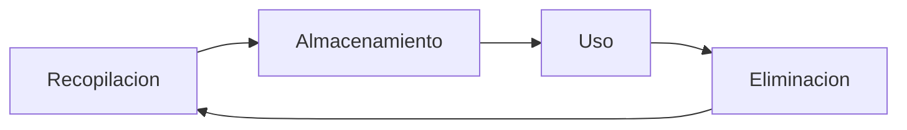
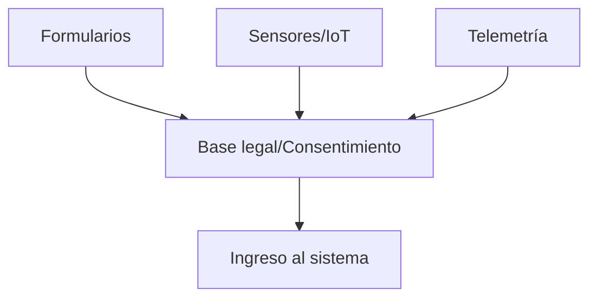
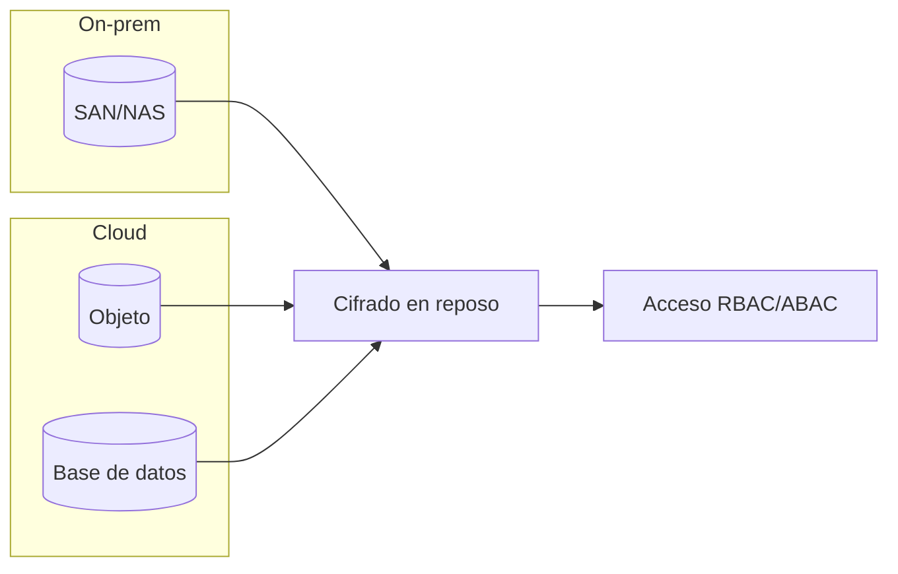
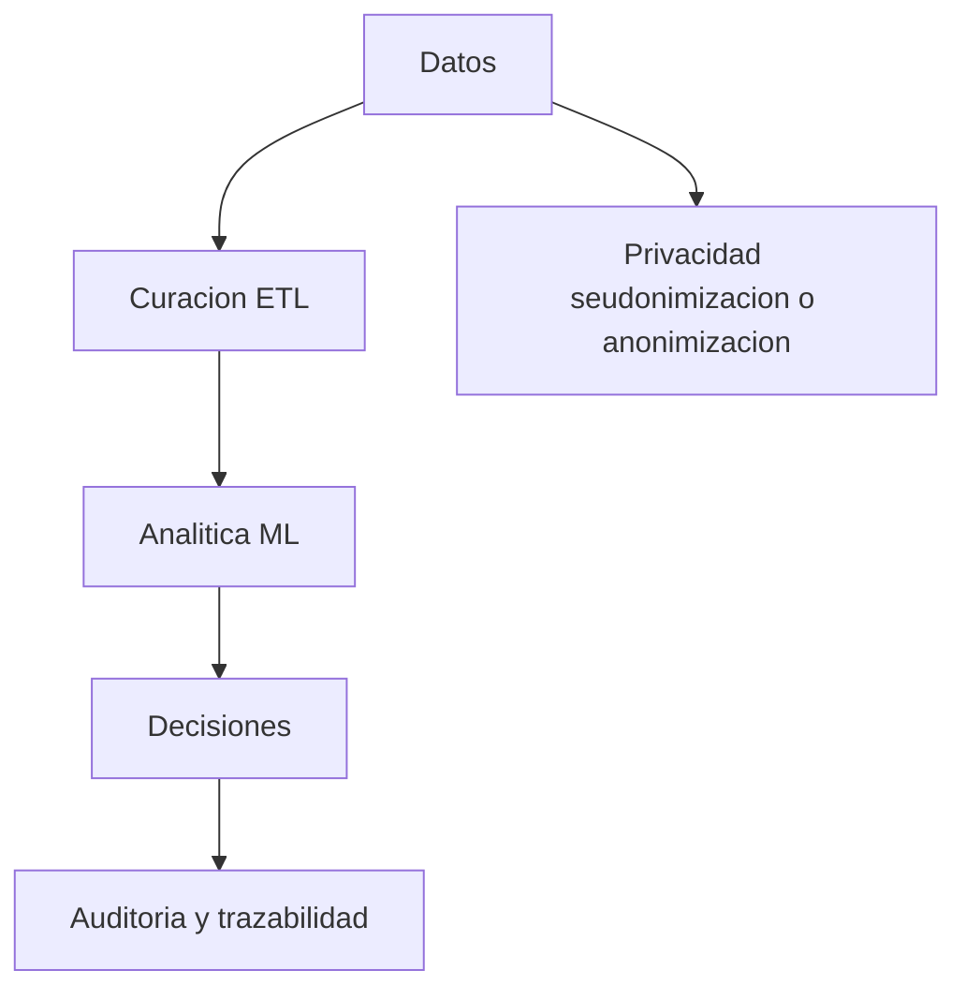
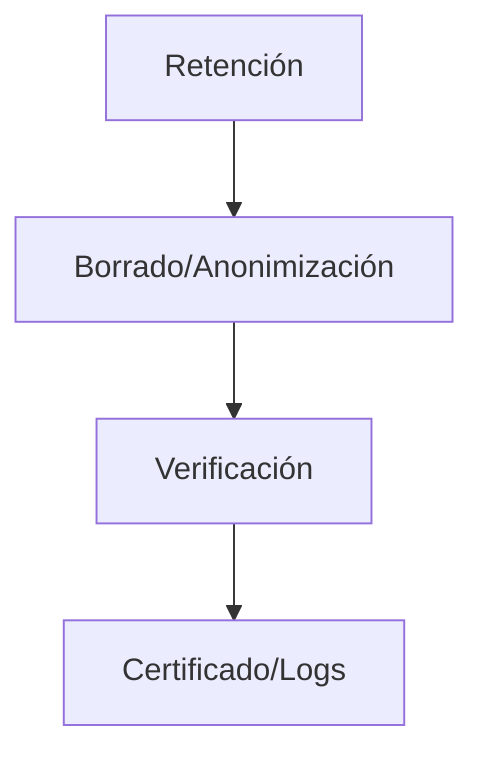
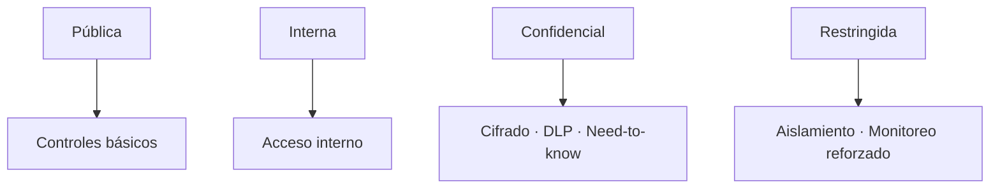
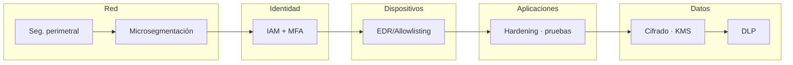

+++
title = "2. Tratamiento de la información"
weight = 2
+++

El tratamiento de la información hace referencia a todas las operaciones y procesos que se realizan sobre los datos, ya sea de forma manual (papel, archivos físicos) o mediante sistemas automatizados (software, bases de datos, algoritmos de inteligencia artificial).

## 2.1. Ciclo de vida de la información

_Ciclo de vida del dato: de la captura a la eliminación._

### 2.1.1. Recopilación

_Fuentes de datos y necesidad de base jurídica/consentimiento._

La recopilación es el punto de entrada de los datos en el sistema. Puede hacerse de forma explícita (cuando el usuario entrega voluntariamente información) o implícita (cuando los sistemas la obtienen automáticamente).

Ejemplos de la vida real:

- Formularios web: al registrarse en una red social, se solicitan nombre, correo electrónico y fecha de nacimiento.
- Sensores IoT: un reloj inteligente recopila ritmo cardíaco y pasos diarios.
- Registros administrativos: en un hospital, el paciente entrega información médica al ingresar.

Riesgo: si en esta fase no se aplican principios de minimización de datos, se puede recopilar más información de la necesaria, aumentando la exposición a brechas de seguridad.

Desde una perspectiva académica y normativa, la fase de recopilación exige al responsable del tratamiento fundamentar la licitud del tratamiento en una base jurídica adecuada (consentimiento, ejecución de un contrato, interés legítimo ponderado, obligación legal, interés vital o misión de interés público), conforme al artículo 6 del RGPD. La obtención de datos debe alinearse con los principios de limitación de la finalidad y minimización, de manera que solo se recojan aquellos datos estrictamente necesarios para los objetivos declarados. La transparencia se materializa a través de cláusulas informativas claras, accesibles y específicas, que describan la identidad del responsable, las finalidades, las bases legales, los destinatarios y los derechos de los interesados. En contextos con categorías especiales de datos (salud, biométricos, origen racial, entre otros), el artículo 9 del RGPD impone salvaguardas reforzadas y bases habilitantes específicas. La ausencia de claridad en esta fase no solo incrementa el riesgo jurídico, sino que dificulta la confianza de los usuarios y compromete la calidad de los datos obtenidos.

Desde el punto de vista técnico, la recopilación puede realizarse mediante mecanismos activos (formularios, encuestas, apps) o pasivos (telemetría, cookies, SDK de terceros, captación por sensores IoT). La irrupción del edge computing permite preprocesar y filtrar datos en el dispositivo, reduciendo la exposición y el volumen transferido a la nube, lo que coadyuva al principio de minimización. Sin embargo, la heterogeneidad de fuentes genera retos de interoperabilidad y de normalización semántica que afectan a la integridad y a la comparabilidad de los conjuntos de datos. Es esencial incorporar controles de calidad (validaciones, detección de valores atípicos, verificación de consistencia) y evitar sesgos de selección que deriven en representaciones distorsionadas, especialmente cuando los datos alimentan modelos analíticos o de aprendizaje automático con impacto en decisiones sociales o económicas.

Conceptos clave: **recopilación**, **consentimiento**, **minimización de datos**, **licitud**.

Caso real: una linterna móvil solicitaba acceso al GPS y a contactos; tras denuncias, el desarrollador actualizó la app para ceñirse al principio de minimización.

### 2.1.2. Almacenamiento

_Opciones de almacenamiento y controles: cifrado y control de acceso._

Una vez recopilados, los datos se conservan en distintos soportes: bases de datos relacionales, servidores en la nube, discos duros físicos o incluso archivos en papel.

En el plano arquitectónico, el almacenamiento de la información abarca múltiples paradigmas: infraestructuras on-premises, nubes públicas/privadas e implementaciones híbridas. A nivel lógico conviven bases de datos relacionales, almacenes NoSQL (clave-valor, documentos, grafos), lagos de datos y almacenamiento de objetos. La elección del sustrato tecnológico condiciona propiedades de seguridad y rendimiento, así como el cumplimiento de requisitos no funcionales (consistencia, disponibilidad, particionamiento). Para preservar la confidencialidad en reposo, se recomienda cifrado nativo del medio con gestión de claves centralizada (KMS, HSM), segregación de entornos y aislamiento de tenants. La integridad se refuerza con sumas de verificación, firmas, control de versiones e inmutabilidad cuando proceda; la disponibilidad, con replicación geográfica y políticas de recuperación definidas.

Los controles de acceso constituyen la primera línea de defensa operativa: modelos RBAC/ABAC, separación de funciones, autenticación robusta y autorización granular por recurso y operación. La implementación de copias de seguridad, versionado y almacenamiento inmutable (WORM) mitiga los efectos de errores humanos y ataques como ransomware. Políticas de retención y borrado alineadas con requisitos legales evitan acumulaciones innecesarias. La confiabilidad del almacenamiento también depende de la higiene de configuración (principio de mínimo privilegio, desactivación de acceso público por defecto, endpoints privados) y del hardening del sistema operativo y del stack de almacenamiento. La monitorización continua de accesos y anomalías, junto con alarmas basadas en comportamiento, contribuye a una detección temprana de incidentes.

Ejemplos:

- Banco: conserva el historial de transacciones de un cliente en un servidor seguro durante el tiempo legalmente requerido.
- Universidad: almacena los expedientes académicos en un sistema de gestión interna.
- Google Drive / Dropbox: servicios en la nube que guardan información personal y laboral de millones de usuarios.

Riesgo: el almacenamiento inseguro o sin cifrado puede derivar en accesos indebidos (ejemplo: filtraciones masivas de contraseñas de LinkedIn en 2012).

Conceptos clave: **almacenamiento**, **cifrado en reposo**, **nube**, **gestión de claves**.

Caso real: un bucket en la nube mal configurado expuso bases de datos de clientes; el uso posterior de cifrado y políticas de acceso minimizó el impacto ante accesos no autorizados.

### 2.1.3. Uso

_Uso legítimo: calidad de datos, analítica y privacidad preservadora._

El uso implica que los datos se procesen con una finalidad legítima y transparente, previamente informada al titular.

El uso de la información debe ajustarse estrictamente al principio de limitación de la finalidad y a la compatibilidad de propósitos establecida por el RGPD. La reutilización de datos con fines secundarios requiere evaluar la relación entre la finalidad original y la nueva, el contexto de obtención, la naturaleza de los datos, las posibles consecuencias y la existencia de salvaguardas adecuadas. En un marco académico, esto se traduce en modelos de gobernanza que articulan catálogos de datos, glosarios de negocio y registros de tratamiento, asegurando coherencia semántica y facilitando el control del linaje (data lineage). La transparencia en el uso, mediante avisos y paneles informativos, mejora la confianza y habilita el ejercicio informado de derechos por parte de los interesados.

Los tratamientos basados en analítica avanzada y aprendizaje automático introducen retos específicos de equidad, explicabilidad y no discriminación. La inferencia de atributos sensibles o la segmentación algorítmica (profiling) puede generar sesgos y resultados adversos para colectivos vulnerables. Por ello, se recomiendan evaluaciones de impacto algorítmico, pruebas de sesgo, documentación de modelos (model cards) y técnicas de privacidad preservadora como la seudonimización, privacidad diferencial o aprendizaje federado. La calidad del dato (completitud, exactitud, actualidad) condiciona la validez de las conclusiones; políticas de curación, control de versiones y validaciones sistemáticas son indispensables para mantener la integridad del análisis.

En la operación diaria, el principio de mínimo privilegio, la segregación de entornos (desarrollo, pruebas, producción) y la separación de funciones limitan la exposición. El acceso just-in-time y la revisión periódica de permisos reducen riesgos de acumulación de privilegios. La auditoría de accesos, la detección de uso anómalo y los mecanismos de trazabilidad permiten identificar desvíos de uso y respaldar la rendición de cuentas. Asimismo, la gestión diligente de solicitudes de derechos (acceso, portabilidad, oposición) y la estructuración de acuerdos de intercambio de datos con terceros, incluyendo cláusulas de uso permitido y prohibido, resultan esenciales para evitar usos indebidos y garantizar el cumplimiento.

Ejemplos:

- Netflix: usa el historial de visionado de cada usuario para recomendar nuevas series mediante algoritmos de machine learning.
- Sanidad pública: analiza datos epidemiológicos para detectar brotes de enfermedades.
- E-commerce: un supermercado online personaliza las ofertas en función del historial de compras del cliente.

Riesgo: un uso no autorizado (ejemplo: escándalo de Cambridge Analytica en 2018, donde se usaron datos de Facebook para manipulación política).

Conceptos clave: **finalidad**, **transparencia**, **legitimación**, **profiling**.

Caso real: el caso Cambridge Analytica evidenció cómo datos recogidos para fines "sociales" se reutilizaron para segmentación política sin consentimiento explícito.

### 2.1.4. Eliminación

_Eliminación segura con verificación y evidencia._

Cuando los datos dejan de ser necesarios, deben ser suprimidos o anonimizados de forma segura, respetando los plazos legales.
La eliminación eficaz se asienta en calendarios de retención definidos por tipología de dato y obligación normativa (fiscal, laboral, sanitaria, sectorial). Estos calendarios deben equilibrar las necesidades operativas con los principios de minimización y almacenamiento limitado, evitando la conservación indefinida por inercia. Las organizaciones han de contemplar situaciones de legal hold, en las que la supresión se suspende temporalmente por requerimientos judiciales o de investigación. Desde un enfoque sistémico, es fundamental identificar todas las copias y proyecciones de un dato a lo largo del ecosistema (respaldos, cachés, índices de búsqueda, entornos de pruebas) para asegurar la coherencia de la supresión.

En términos técnicos, la eliminación puede implementarse mediante borrado lógico (marcado de registros para no ser usados), sobrescritura segura de sectores, destrucción de claves criptográficas (crypto-shredding) o sanitización conforme a estándares como NIST SP 800-88. La elección del método depende del soporte (HDD, SSD, cintas, papel) y de la sensibilidad de la información. La verificación de la supresión, mediante muestreo, logs de borrado y certificaciones de proveedores, es imprescindible para reducir el riesgo residual. En entornos cloud, debe atenderse a instantáneas, réplicas y colas de mensajes, donde pueden persistir referencias a datos supuestamente eliminados.

Ejemplos:

- Entidad bancaria: elimina registros de operaciones pasados X años, según normativa de prevención de blanqueo de capitales.
- Empresa de RRHH: borra los CV de candidatos no seleccionados después de un tiempo prudencial.
- Universidad: destruye exámenes en papel tras digitalizar y finalizar el proceso de reclamaciones.

Riesgo: no eliminar correctamente datos sensibles puede provocar su recuperación por terceros (ejemplo: venta de discos duros usados en eBay que aún contenían historiales clínicos).

Conceptos clave: **plazos de conservación**, **supresión**, **anonimización**, **borrado seguro**.

Caso real: una empresa recicló equipos sin sobrescritura; investigadores recuperaron datos sensibles, lo que derivó en una notificación de brecha y sanción.

Conceptos clave: **responsable del tratamiento**, **encargado del tratamiento**, **contratos de encargo**, **notificación de brechas**.

Caso real: tras un incidente en su proveedor cloud, una clínica notificó en 72 horas a la AEPD y a los afectados, cumpliendo el RGPD y mitigando el impacto reputacional.

## 2.2. Clasificación de la información

_Niveles de clasificación y ejemplos de controles asociados._

La clasificación de la información consiste en asignar niveles de protección en función de la sensibilidad, el valor y el riesgo que supone su exposición.

La clasificación de la información constituye un pilar de la gobernanza del dato al permitir modular controles según la sensibilidad y el impacto potencial de exposición, alteración o pérdida. Desde un enfoque metodológico, se parte de un inventario de activos informacionales y de un análisis de impacto en el negocio (BIA) que relaciona cada activo con procesos críticos, dependencias y tolerancias temporales. Los criterios de valoración deben considerar aspectos estratégicos, reputacionales, regulatorios y de seguridad, evitando una hipertrofia de la categoría máxima que termine por banalizarla. El patrocinio directivo y el alineamiento con la gestión de riesgos corporativos facilitan la adopción uniforme en todas las áreas.

El ciclo de vida de la clasificación requiere revisiones periódicas, gestión de excepciones justificadas y retroalimentación de incidentes y auditorías para ajustar criterios y controles. La sensibilización del personal es determinante: comprender qué implica cada etiqueta y cómo manejarla en la práctica reduce errores operativos.

El hallazgo de datos “huérfanos” o de sistemas en la sombra (shadow IT) demanda procesos de descubrimiento continuo y regularización. Finalmente, una clasificación efectiva facilita el cumplimiento normativo al demostrar proporcionalidad en las medidas adoptadas y dota de eficiencia a la respuesta ante incidentes al priorizar la contención de activos más críticos.

Niveles comunes y ejemplos:

- Información pública
  - Datos accesibles sin restricción.
  - Ejemplo: notas de prensa de una institución, horarios de transporte público.
- Información interna
  - Uso exclusivo dentro de la organización.
  - Ejemplo: manuales de procedimientos de una empresa.
- Información confidencial
  - Requiere un control de acceso, ya que su filtración puede causar daños.
  - Ejemplo: contratos de clientes, estrategias de marketing, expedientes médicos.
- Información restringida
  - Máxima protección; su pérdida tendría un impacto crítico.
  - Ejemplo: credenciales de acceso a sistemas financieros, algoritmos propios de Google, planos de infraestructuras críticas.

Criterios de clasificación:

- Valor: importancia estratégica o económica.
- Impacto: consecuencias de divulgación, pérdida o alteración.
- Requisitos legales: leyes que obligan a niveles específicos (ej. protección reforzada de datos biométricos o de salud en el RGPD).

Caso real: en 2014, el robo de información confidencial de Sony Pictures expuso correos internos y estrategias de negocio, causando graves pérdidas económicas y de reputación.

Conceptos clave: **pública**, **interna**, **confidencial**, **restringida**, **impacto**.

Caso real: el incidente de Sony Pictures demostró cómo tratar como interna información que debía ser confidencial incrementó el daño de la filtración.

## 2.3. Protección de la información

_Defensa en profundidad por capas y Zero Trust._

Para proteger bien la información, piensa en un castillo: no basta con una muralla, hacen falta varias. A eso lo llamamos defensa en profundidad: colocar diferentes barreras en puntos distintos del sistema para que, si una falla, otra detenga o retrase al atacante. En la práctica, combinamos medidas para prevenir incidentes, detectar rápidamente lo anómalo y responder y recuperarnos con eficacia. Más capas implican más dificultad para el adversario y más tiempo para que tú puedas reaccionar.

Por capas, hablamos de red, identidad, dispositivos (endpoint), aplicaciones y datos. El enfoque Zero Trust (confianza cero) resume una idea sencilla: no confiar por defecto aunque el acceso venga “desde dentro”; verificar cada petición, dar solo los permisos mínimos necesarios y asumir que en algún momento puede haber un equipo comprometido. Técnicas como la segmentación y microsegmentación de red, el aislamiento de entornos (desarrollo, pruebas y producción) y el endurecimiento de sistemas (configurar seguro por defecto y reducir servicios innecesarios) cortan el movimiento lateral y disminuyen la superficie de ataque.

En el plano técnico, hay controles clave que conviene interiorizar:

- Gestión de identidades y accesos (IAM) con autenticación multifactor resistente al phishing, revisión periódica de permisos y accesos “just‑in‑time”.
- Protección de equipos con EDR/XDR y listas blancas de ejecución (allowlisting) para limitar qué puede correr en los endpoints.
- Monitorización con SIEM y orquestación/automatización (SOAR) para correlacionar eventos y ejecutar respuestas guiadas por playbooks.
- Gestión de vulnerabilidades y parcheo continuo, apoyados en escaneos regulares y verificación de configuración (p. ej., CIS Benchmarks).
- Cifrado de datos en tránsito (TLS) y en reposo, con gestión segura de claves (KMS/HSM), rotación y separación de funciones.

Nada de esto funciona sin la parte organizativa. Hacen falta políticas claras y conocidas, formación continua y simulaciones (campañas de phishing, ejercicios de mesa) para construir cultura de seguridad. La preparación se plasma en planes de respuesta a incidentes, continuidad de negocio y recuperación ante desastres, que deben probarse y medirse (MTTD, MTTR). La gestión de cambios, el análisis de amenazas en el diseño (threat modeling) y las auditorías contribuyen a la mejora continua. Y, sobre todo, es clave la colaboración entre TI, seguridad, cumplimiento y negocio para alinear la protección con los riesgos reales y los objetivos de la organización.

Tipos de controles:

- Controles físicos
  - Restringen el acceso a instalaciones y equipos.
  - Ejemplos: cerraduras electrónicas, cámaras de vigilancia, guardias de seguridad, tarjetas de identificación.
  - Caso real: en centros de datos de Amazon Web Services (AWS), el acceso físico está limitado con biometría y vigilancia 24/7.
- Controles técnicos
  - Basados en herramientas tecnológicas.
  - Ejemplos: cifrado, firewalls, antivirus, autenticación multifactor (MFA), sistemas de detección de intrusiones (IDS/IPS).
  - Caso real: tras el ataque de ransomware WannaCry (2017), muchos hospitales tuvieron que reforzar la seguridad técnica de sus redes.
- Controles administrativos
  - Basados en políticas, normas y formación.
  - Ejemplos: políticas de contraseñas, formación en phishing, planes de respuesta a incidentes.
  - Caso real: en 2020, un empleado de Twitter fue engañado (ingeniería social), lo que permitió a atacantes tomar el control de cuentas verificadas.

Conceptos clave: **defensa en profundidad**, **controles físicos**, **controles técnicos**, **controles administrativos**, **formación**.

Caso real: después de WannaCry, hospitales implantaron segmentación de red, parches regulares y formación antiphishing, reduciendo drásticamente incidentes.

### Tabla comparativa — Sección 2

| Fase/rol | Riesgo clave | Medidas recomendadas | Evidencias |
|---|---|---|---|
| Recopilación | Exceso de datos, base legal débil | Minimización, información clara, consentimiento válido | Cláusulas informativas, registros de consentimiento |
| Almacenamiento | Accesos indebidos, pérdida | Cifrado, backups, control de accesos, hardening | Configuraciones, inventario de activos, pruebas de restauración |
| Uso | Deriva de finalidad, sesgos | Gobernanza, seudonimización, controles de acceso | ROPA, data lineage, revisiones de permisos |
| Eliminación | Persistencia en copias | Calendarios de retención, sanitización | Logs de borrado, certificados, políticas |
| Responsable/Encargado | Falta de control a terceros | DPA, evaluación de proveedores, auditorías | Contratos, informes SOC 2/ISO, planes de respuesta |

### Ejemplos reales (extra)

- Errores de configuración en cloud dejaron buckets públicos expuestos hasta su cierre y cifrado.
- Reutilización de datos de apps para fines publicitarios conllevó sanciones por falta de transparencia.
- Borrado incompleto en discos reciclados permitió recuperar historiales; implantación posterior de NIST SP 800-88.

### Resumen de la sección 2

- El ciclo de vida (recopilar, almacenar, usar, eliminar) requiere controles específicos en cada fase.
- La gobernanza (ROPA, DPIA, DPA) y la rendición de cuentas sostienen el cumplimiento.
- La calidad, seguridad y privacidad del dato son interdependientes.
- Los terceros y la nube exigen contratos y verificaciones continuas.

---
