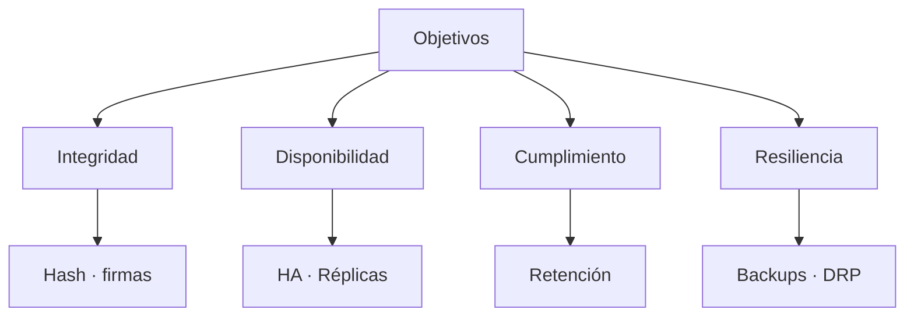
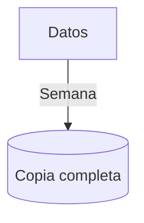
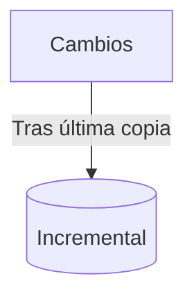
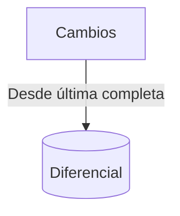
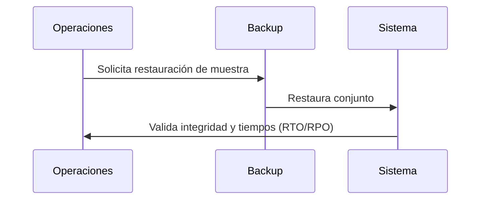
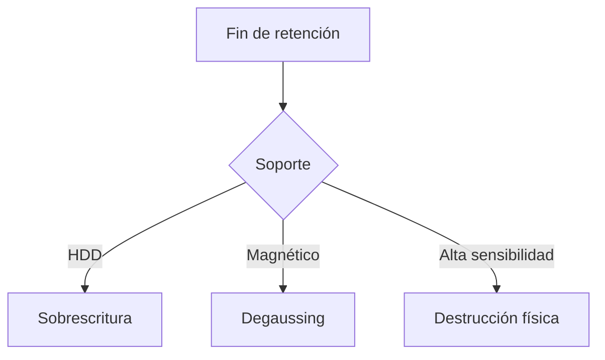
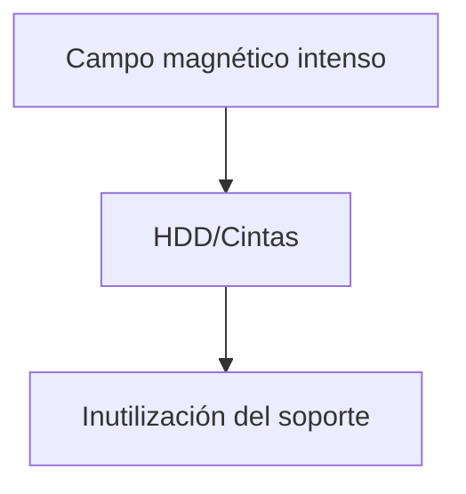
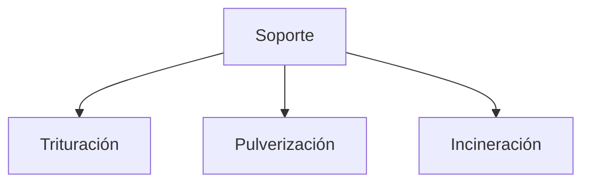

+++
title = "3. Almacenamiento de la información"
weight = 3
+++

## Importancia del almacenamiento seguro

_Objetivos del almacenamiento seguro y controles asociados._

El almacenamiento de la información constituye una de las funciones críticas en la gestión de datos. No se trata únicamente de guardar archivos en un soporte físico o en la nube, sino de garantizar que los datos permanezcan íntegros, disponibles y protegidos frente a pérdidas accidentales, accesos no autorizados o desastres imprevistos.

Objetivos clave:

- Preservar la integridad: que la información no sea alterada sin autorización.
- Asegurar la disponibilidad: acceso a los datos cuando se requieran, evitando caídas o bloqueos.
- Cumplimiento normativo: conservar información durante períodos determinados (p. ej., documentación contable en España durante 6 años).
- Resiliencia: capacidad de recuperar la información tras fallos técnicos, ataques o catástrofes.

Conceptos clave: **integridad**, **disponibilidad**, **cumplimiento**, **resiliencia**.

Caso real: tras un incendio en una oficina, una pyme restauró sus sistemas en 24 horas gracias a copias off-site y un plan de continuidad probado.

## 3.1. Copias de seguridad

_Combinación de tipos de copia y validación periódica._

Las copias de seguridad (backups) son la herramienta más efectiva para garantizar la continuidad del negocio y la recuperación de la información tras un incidente. Representan la última línea de defensa frente a ataques como el ransomware o a fallos de hardware.

### Copia completa

_Copia íntegra periódica de todos los datos._

- Réplica íntegra de todos los datos seleccionados.
- Ventajas: recuperación rápida y sencilla.
- Desventajas: mayor tiempo y espacio de almacenamiento.
- Ejemplo: copia semanal de toda la base de datos de una empresa.

Conceptos clave: **backup completo**, **RTO**, **espacio de almacenamiento**.

Caso real: un despacho legal recuperó rápidamente expedientes tras un ransomware gracias a su copia completa más reciente.

### Copia incremental

_Solo cambios desde la copia previa (completa o incremental)._

- Solo almacena los cambios desde la última copia (completa o incremental).
- Ventajas: ahorro de espacio y tiempo.
- Desventajas: restauración más compleja (depende de varias copias encadenadas).

Conceptos clave: **backup incremental**, **ventana de copia**, **cadena de restauración**.

Caso real: un e-commerce minimizó el tiempo de copia diaria usando incrementales, asumiendo una restauración algo más lenta pero suficiente para su RTO.

### Copia diferencial

_Todos los cambios desde la última completa._

- Guarda todos los cambios desde la última copia completa.
- Ventajas: equilibrio entre rapidez y espacio.
- Desventajas: requiere más almacenamiento que la incremental.

Conceptos clave: **backup diferencial**, **equilibrio espacio/tiempo**, **restauración**.

Caso real: una startup combinó copia completa semanal con diferenciales diarios para equilibrar almacenamiento y rapidez de recuperación.

### Estrategia 3-2-1

_Estrategia 3-2-1: 3 copias, 2 soportes, 1 externa/inmutable._

- 3 copias de los datos importantes.
- 2 soportes diferentes (por ejemplo, disco local y almacenamiento en la nube).
- 1 copia en una ubicación externa (off-site).

### Pruebas periódicas

_Pruebas periódicas de restauración para validar RTO/RPO._

Práctica recomendada: realizar pruebas de restauración periódicas para validar integridad y tiempos de recuperación (RTO).

Conceptos clave: **3-2-1**, **off-site**, **inmutabilidad**, **pruebas de restauración**.

Caso real: una empresa descubrió que su proveedor de backup no guardaba metadatos críticos al ejecutar un simulacro; ajustó la configuración antes de sufrir un incidente real.

## 3.2. Borrado seguro de la información

_Selección de método de borrado según soporte y sensibilidad._

Borrar un archivo no implica eliminarlo definitivamente: normalmente desaparece la referencia del sistema, pero los datos siguen en el soporte hasta que se sobrescriben.

Conceptos clave: **borrado lógico**, **recuperación forense**, **ciclo de vida**.

Caso real: equipos subastados por una organización conservaban archivos borrados recuperables; tras el hallazgo, adoptaron políticas de borrado seguro certificadas.

### 3.2.1. Métodos de borrado seguro

#### Sobrescritura

- **Qué es**: reescritura de sectores con patrones (aleatorio, 0x00, 0xFF) para invalidar datos previos.
- **Cuándo usarlo**: equipos a **reutilizar** o **ceder** dentro de la organización; HDD y ciertos SSD según fabricante.
- **Ventajas**: **bajo coste**, permite **reutilización** del soporte, controlable por el propio equipo.
- **Limitaciones**: en **SSD** y **RAID** puede no garantizar cobertura total si no se usa método recomendado por el **fabricante**; más **lento** en grandes volúmenes.
- **Buenas prácticas**: ejecutar **múltiples pasadas** cuando proceda, incluir **verificación**, registrar **logs/certificados** de borrado y comprobar **muestras**.

#### Degradación magnética (degaussing)

_Degradación magnética de soportes magnéticos._

- Aplicación de un campo magnético intenso que inutiliza soportes magnéticos (HDD, cintas). Destruye el soporte.

- **Qué es**: aplicación de **campo magnético** intenso que desorienta dominios magnéticos.
- **Cuándo usarlo**: retirada de **HDD/cintas** con datos sensibles o cuando el soporte no se va a reutilizar.
- **Ventajas**: **rápido** e **irreversible** en soportes magnéticos.
- **Limitaciones**: no válido para **SSD**; requiere **equipos** específicos y manejo **seguro**.
- **Buenas prácticas**: documentar **número de serie**, mantener **equipos calibrados**, combinar con **destrucción física** si es necesario.

#### Destrucción física

_Destrucción física para información altamente sensible._

- Trituración, pulverización o incineración. Método definitivo para información altamente sensible.

- **Qué es**: **triturar**, **pulverizar** o **incinerar** el soporte hasta tamaños certificados.
- **Cuándo usarlo**: información de **alta sensibilidad** o requisitos regulatorios estrictos.
- **Ventajas**: **irreversible** para cualquier soporte (HDD, SSD, móviles, papel).
- **Limitaciones**: **coste** y logística; imposibilita la **reutilización** del soporte.
- **Buenas prácticas**: exigir **certificado** del proveedor, observar **tamaños de partícula** normativos, cadena de **custodia** y **testigos** cuando aplique.

Conceptos clave: **sobrescritura**, **degaussing**, **destrucción física**.

Caso real: una administración destruyó físicamente discos con información clasificada al finalizar su vida útil para impedir cualquier recuperación.

### 3.2.2. Importancia del borrado seguro

_Riesgos por borrado inadecuado y mitigaciones._

- Prevención de fugas: muchos incidentes surgen al vender o reciclar equipos sin borrado adecuado.
- Cumplimiento normativo: el RGPD exige la supresión efectiva de datos personales cuando dejan de ser necesarios.
- Optimización de recursos: libera espacio sin comprometer la seguridad.

Conceptos clave: **prevención de fugas**, **cumplimiento RGPD**, **retención y borrado**.

Caso real: una cadena minorista fue multada tras vender TPVs con datos de clientes; la posterior implantación de borrado certificado evitó recurrencias.

### Tabla comparativa — Sección 3

| Tipo de copia | Qué guarda | Ventajas | Desventajas | Uso típico |
|---|---|---|---|---|
| Completa | Todo el conjunto | Restauración rápida | Tiempo/espacio elevados | Hitos semanales |
| Incremental | Cambios desde última copia (cualquiera) | Copias rápidas, poco espacio | Restauración encadenada | Diaria/frecuente |
| Diferencial | Cambios desde última completa | Equilibrio copia/restauración | Más espacio que incremental | Diaria junto a semanal completa |

| Método de borrado | Soporte principal | Reversibilidad | Coste | Uso recomendado |
|---|---|---|---|---|
| Sobrescritura | HDD/SSD (según fabricante) | Baja si varias pasadas | Bajo/medio | Activos reutilizables |
| Degaussing | Magnéticos (HDD, cintas) | Irreversible | Medio | Retirada de soportes magnéticos |
| Destrucción física | Cualquier soporte | Irreversible | Medio/alto | Información altamente sensible |

### Ejemplos reales — Sección 3

- Simulacro de DR reveló que faltaban claves API en backups; se ajustó alcance y verificación.
- Copias en la misma oficina quedaron inutilizadas tras inundación; se adoptó 3-2-1 con off-site.
- SSD retirados sin sanitización contenían credenciales; se pasó a destrucción certificada.

### Resumen de la sección 3

- Las copias son la última línea ante fallos y ransomware; probar la restauración es crítico.
- Combinar completa + incremental/diferencial optimiza RTO/RPO y costos.
- El borrado seguro previene fugas al final del ciclo de vida del soporte.
- La estrategia 3-2-1 y la inmutabilidad elevan la resiliencia.

---
