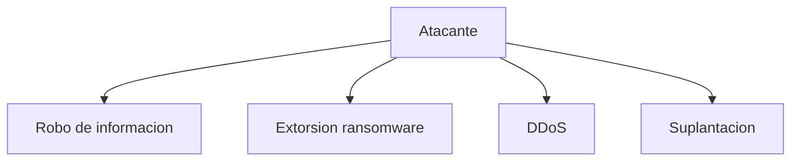
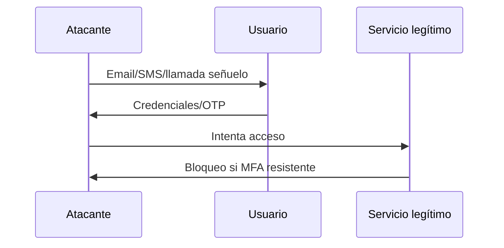
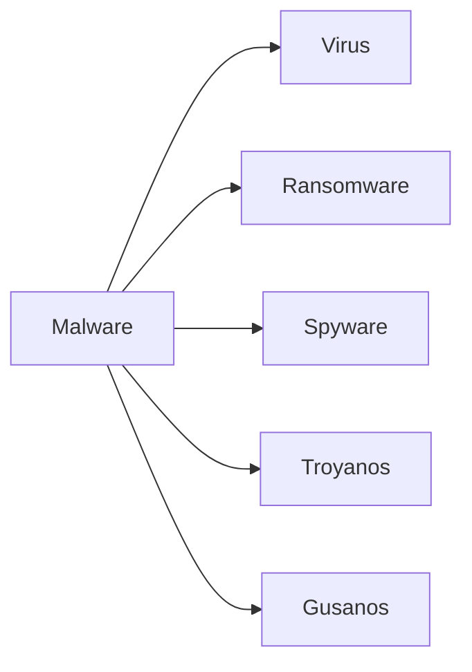
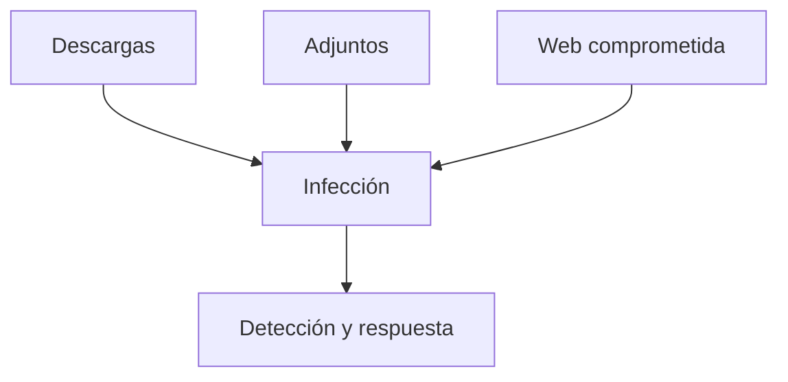

+++
title = "4. Principales amenazas a la información"
weight = 4
+++

## 4.1. Panorama actual

_Factores del panorama actual de amenazas._

- Mayor volumen: cada minuto se registran millones de intentos de intrusión.
- Más sofisticación: uso de IA, ingeniería social avanzada y malware polimórfico.
- Impacto económico: el coste global del cibercrimen podría superar los 10,5 billones de dólares anuales en 2025 (Cybersecurity Ventures, 2023).
- Impacto reputacional: una brecha puede destruir la confianza en horas.

Conceptos clave: **ransomware**, **ingeniería social**, **IA en ataques**, **coste del cibercrimen**.

Caso real: múltiples hospitales europeos reportaron en 2020-2022 interrupciones por ransomware, acelerando inversiones en ciberseguridad sanitaria.

## 4.2. Objetivos de los atacantes

_Objetivos frecuentes de los atacantes._

- Robo de información: datos financieros, credenciales, secretos industriales.
- Extorsión económica: ransomware que bloquea sistemas hasta el pago de un rescate.
- Interrupción de servicios: DDoS.
- Suplantación de identidad: fraudes con identidades digitales.

Ejemplo real: en 2021, el ataque de ransomware a Colonial Pipeline paralizó un oleoducto clave en EE. UU. y motivó un pago de 4,4 millones de dólares.

Conceptos clave: **robo de información**, **extorsión**, **DDoS**, **suplantación de identidad**.

Caso real: un banco sufrió un DDoS que dejó inoperativa su web durante horas; la entidad desplegó mitigación y redundancia para evitar nuevos impactos.

## 4.3. Phishing

_Flujo típico de phishing y mitigación con MFA resistente._

El phishing consiste en suplantar identidad para engañar al usuario y obtener información confidencial.

Tipos de phishing:

- Email phishing: correos que simulan ser de bancos o servicios.
- Smishing: a través de SMS.
- Vishing: mediante llamadas telefónicas.
- Spear phishing: ataques dirigidos con mensajes personalizados.

Señales de alerta:

- Mensajes con urgencia o amenazas.
- Errores gramaticales o traducciones pobres.
- Remitentes sospechosos o dominios que no son oficiales.
- Enlaces acortados o con direcciones poco claras.

Prevención:

- Verificar siempre la procedencia.
- No hacer clic en enlaces sospechosos.
- Usar autenticación multifactor para mitigar el impacto aunque se filtren credenciales.

Ejemplo real: en 2020, spear phishing contra empleados de Twitter permitió tomar el control de cuentas verificadas para fraudes con criptomonedas.

Conceptos clave: **phishing**, **smishing**, **vishing**, **spear phishing**, **señales de alerta**.

Caso real: una pyme evitó pérdidas cuando un empleado detectó un dominio falso (typosquatting) en un correo de “proveedor” y reportó el intento.

## 4.4. Malware

_Principales tipos de malware._

El término malware abarca cualquier programa diseñado para infiltrarse o dañar un sistema.

### Tipos principales

_Vectores de infección y respuesta._

- Virus: se adjuntan a archivos y se ejecutan al abrirlos.
- Ransomware: bloquea datos y exige un rescate.
- Spyware: recopila información sin consentimiento (contraseñas, hábitos).
- Troyanos: se hacen pasar por software legítimo y crean accesos ocultos.
- Gusanos: se propagan automáticamente por redes.

Vías de infección:

- Descargas desde sitios no seguros.
- Archivos adjuntos en correos fraudulentos.
- Páginas web comprometidas o anuncios maliciosos.

Medidas de protección:

- Antivirus actualizados.
- Políticas de navegación segura.
- Concienciación sobre los riesgos de abrir archivos o enlaces sospechosos.

Ejemplo real: en 2017, el ransomware WannaCry afectó a más de 200.000 equipos en 150 países, paralizando servicios como el NHS británico.

Conceptos clave: **virus**, **ransomware**, **spyware**, **troyanos**, **gusanos**, **medidas de protección**.

Caso real: una administración pública contuvo un brote de malware gracias a listas blancas de ejecución y segmentación de red, limitando la propagación.

### Tabla comparativa — Sección 4

| Amenaza | Vector típico | Señales de alerta | Impacto probable | Medidas de mitigación |
|---|---|---|---|---|
| Phishing | Email/SMS/llamada | Urgencia, dominios extraños, adjuntos | Robo de credenciales, fraude | Concienciación, MFA, filtros |
| Ransomware | Adjuntos, RDP expuesto, exploits | Archivos cifrados, notas de rescate | Paralización operativa | Segmentación, parches, backups |
| DDoS | Botnets hacia servicios | Latencia alta, caídas | Indisponibilidad | CDN, WAF, mitigación DDoS |
| Spyware/Troyanos | Software falso, cracks | Procesos sospechosos, exfiltración | Pérdida de datos | EDR, allowlisting, educación |

### Ejemplos reales — Sección 4

- Campaña de spear phishing a directivos de empresas energéticas para robar accesos VPN.
- Ataques DDoS contra banca en línea durante eventos comerciales masivos.
- Ransomware en administración local: restauración desde backups evitó pago de rescate.

### Resumen de la sección 4

- El panorama de amenazas combina ingeniería social y explotación técnica.
- La detección y respuesta tempranas reducen el impacto económico y reputacional.
- La MFA, segmentación, parcheo y formación son medidas transversales efectivas.
- La preparación (playbooks, simulacros) acelera la recuperación.

---
