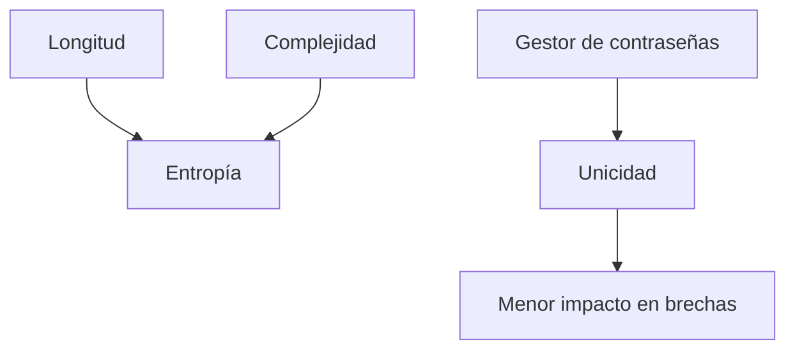
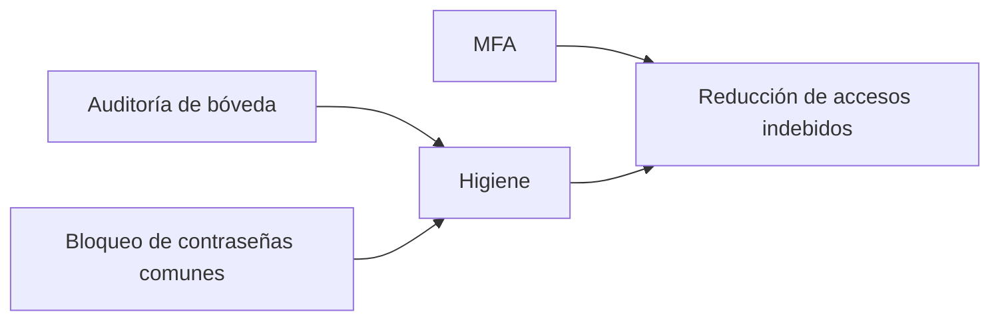
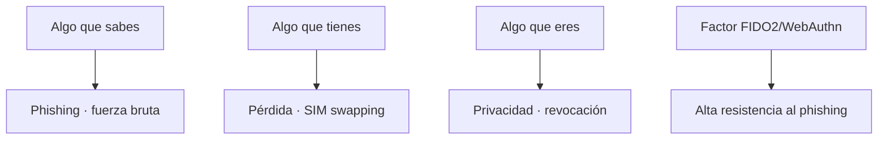

+++
title = "5. Contraseñas y autenticación"
weight = 5
+++

## 5.1. La importancia de las contraseñas

_Factores que aumentan la entropía y reducen el riesgo._

- Una **contraseña** robusta debe combinar **longitud** (preferiblemente ≥ **14** caracteres) y **complejidad** (mezcla de letras, números y símbolos) o, mejor aún, una **passphrase** formada por varias palabras aleatorias.
- La **entropía** efectiva aumenta más por la longitud que por símbolos exóticos; prioriza frases largas y únicas frente a patrones predecibles.
- Evita la **reutilización**: una filtración en un servicio expone cuentas en otros; usa un **gestor de contraseñas** para generar y almacenar claves únicas.
- Distingue entre ataques **en línea** (limitados por intentos) y **fuera de línea** (cracking de hashes); para estos últimos, la longitud es decisiva.
- Activa alertas de **credenciales expuestas** y cambia inmediatamente las afectadas; verifica si tus correos aparecen en bases públicas.

Conceptos clave: **longitud**, **complejidad**, **no reutilización**, **gestores de contraseñas**.

Caso real: una brecha expuso contraseñas reutilizadas; usuarios que repetían la misma clave en varios servicios vieron comprometidas sus cuentas en cadena.

## 5.2. Buenas prácticas en la gestión de contraseñas

_Buenas prácticas que elevan la higiene de credenciales y reducen ataques._

- Habilita **MFA** siempre que sea posible; prioriza métodos **resistentes al phishing** (por ejemplo, **FIDO2/WebAuthn** con llaves de seguridad).
- Usa un **gestor de contraseñas** con sincronización segura, **cifrado** de bóveda y opción de **auditoría** (detección de contraseñas débiles/repetidas).
- Define políticas basadas en **riesgo**: no fuerces cambios periódicos innecesarios; sí exige cambio tras **sospecha de compromiso**.
- Bloquea **contraseñas comunes** y filtradas (listas de denegación); impón **mínimos de longitud** y evita requisitos que induzcan patrones predecibles.
- Implementa **protecciones anti-fuerza bruta**: límites de intento, **CAPTCHA** adaptativo y **listas de bloqueo** por IP anómala.
- Establece **procedimientos de recuperación** seguros: verificación de identidad, **códigos de respaldo** y revocación de factores perdidos.

Conceptos clave: **MFA**, **rotación basada en riesgo**, **phishing-resistant MFA**, **contraseñas únicas**.

Caso real: tras implementar MFA y un gestor corporativo, una empresa redujo en 90% los accesos no autorizados por credenciales filtradas.

## 5.3. Autenticación multifactor (MFA)

### Factores de autenticación

_Comparativa de factores y fortaleza frente a phishing._

- **Algo que sabes**: contraseña o **PIN**; vulnerable a **phishing** y **shoulder surfing**.
- **Algo que tienes**: **token hardware** (FIDO2), app **TOTP** o **push**; los SMS son más débiles por **SIM swapping**.
- **Algo que eres**: **biometría** (huella, rostro); cómodo pero con retos de **privacidad** y **revocación**.
- Recomendado: factores **resistentes al phishing** (FIDO2/WebAuthn), con **enrolamiento** controlado, **códigos de recuperación** y políticas de **revocación**.

Conceptos clave: **algo que sabes**, **algo que tienes**, **algo que eres**, **tokens FIDO2**.

Caso real: un ataque de phishing obtuvo la contraseña de un directivo, pero el uso de llave física FIDO2 bloqueó el acceso.

### Tabla comparativa — Sección 5

| Factor | Ejemplos | Fortalezas | Debilidades |
|---|---|---|---|
| Algo que sabes | Contraseña, PIN, passphrase | Fácil de desplegar | Phishing, reutilización, fuerza bruta |
| Algo que tienes | Token FIDO2, app OTP, SMS | Resistencia a phishing (FIDO2) | Pérdida/robo del dispositivo |
| Algo que eres | Huella, rostro, voz | No se puede “olvidar” | Privacidad, spoofing, revocación |

### Ejemplos reales — Sección 5

- Campañas de password spraying tuvieron éxito en cuentas sin MFA; se mitigó con FIDO2.
- Robo de móvil con app OTP comprometió accesos; política de revocación inmediata evitó abuso.
- Gestores de contraseñas permitieron contraseñas únicas largas sin fricción para usuarios.

### Resumen de la sección 5

- Las contraseñas por sí solas son insuficientes; combinar con MFA es esencial.
- Factores resistentes al phishing (FIDO2) ofrecen la mayor protección práctica.
- La higiene de contraseñas (no reutilizar, longitud) y gestores reducen riesgos dramáticamente.
- Las políticas de revocación y recuperación deben estar definidas y probadas.

---
