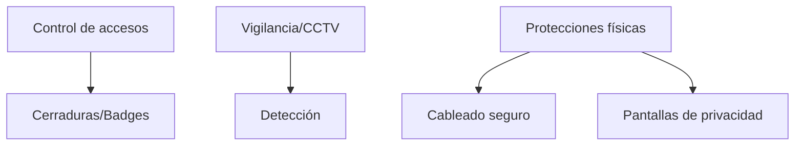
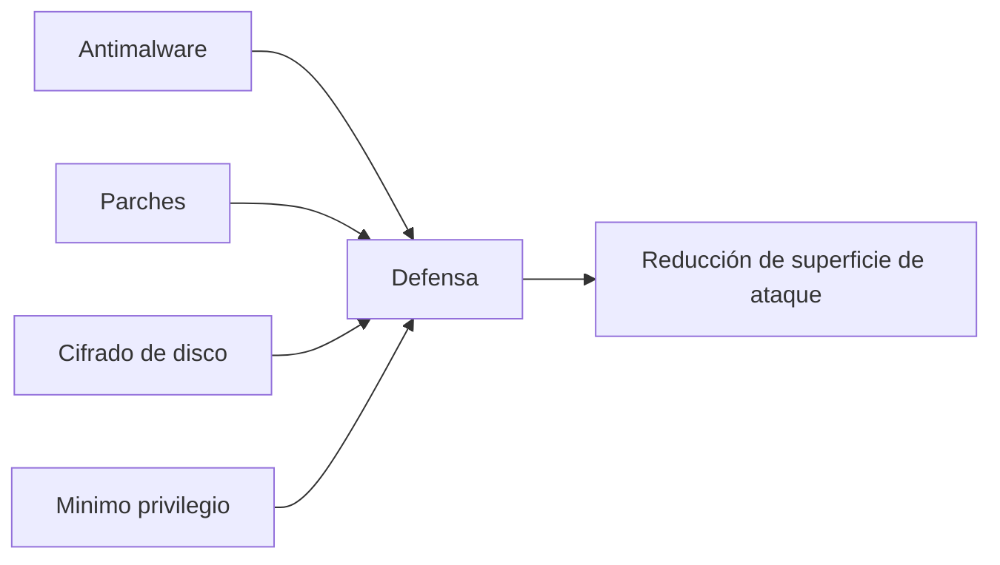

+++
title = "6. Protección del puesto de trabajo"
weight = 6
+++

## 6.1. Medidas de protección física

La seguridad física protege personas, equipos y soportes frente a robo, pérdida, manipulación y daños ambientales. Es la primera barrera: si un atacante obtiene acceso físico a un equipo o a la sala, puede eludir controles lógicos. Por ello, conviene combinar diseño de espacios, controles de acceso, hábitos del personal y procedimientos operativos.

Riesgos frecuentes:

- Robo de portátiles y móviles en oficinas, aulas, cafeterías o transporte.
- Visualización accidental o maliciosa de pantalla (shoulder surfing) en espacios compartidos.
- Extracción de soportes (USB, discos) o documentos impresos sin control.
- Daños por agua, polvo, temperatura, incendios o alimentación eléctrica inestable.

Buenas prácticas en sede y aula:

- Control de accesos por capas: recepción/torniquetes, tarjetas personalizadas, visitantes registrados y acompañados, registros de acceso.
- Zonas seguras para equipos críticos (CPD, racks) con cerraduras, cámaras (CCTV) y sensores (apertura, humedad, temperatura, humo).
- Estaciones de trabajo seguras: anclajes o cables de seguridad para portátiles, cajones con llave para soportes y documentos, impresoras con liberación segura (pull printing).
- Política de “mesa limpia y pantalla bloqueada”: bloquear sesión al ausentarse; evitar papeles sensibles a la vista.
- Gestión de soportes: etiquetado de activos, custodia de llaves y tarjetas, destrucción certificada de papel y medios al final de su vida útil.
- Protección eléctrica y ambiental: SAI/UPS, regletas certificadas, cableado ordenado, mantenimiento preventivo.

Trabajo remoto y movilidad:

- Evitar dejar equipos en vehículos; usar mochilas discretas y cable de seguridad en bibliotecas/cafeterías.
- Usar filtros de privacidad en pantalla en espacios públicos; no atender llamadas sensibles en lugares concurridos.
- Custodiar documentos y soportes en el domicilio en lugares cerrados; no mezclar con material personal.
- Activar localización y borrado remoto, y notificar de inmediato pérdidas o robos.

_Controles físicos típicos para el puesto y la sala._

Conceptos clave: **control de accesos**, **CCTV**, **mesa limpia**, **pantalla bloqueada**, **anclaje de equipos**, **SAI/UPS**, **destrucción certificada**.

Caso real: a un docente le sustrajeron el portátil en una biblioteca. El equipo estaba anclado y cifrado (BitLocker con TPM) y la sesión bloqueada. Se reportó el incidente, se activó el borrado remoto y no fue necesario notificar brecha porque no existía acceso a datos sin credenciales.

## 6.2. Medidas de protección lógica

### Áreas principales

La protección lógica del puesto de trabajo reduce la superficie de ataque y contiene incidentes cuando se materializan. El endpoint es hoy el “primer perímetro” y debe gestionarse con principios de confianza cero, mínimo privilegio y configuración segura por defecto. Esta capa combina hardening del sistema, gestión de identidades, controles de ejecución y telemetría continua para detección y respuesta.

Controles esenciales en el puesto:

- Endurecimiento y configuración segura: aplicar guías (CIS Benchmarks), deshabilitar servicios innecesarios, reforzar políticas (GPO/MDM), activar arranque seguro (UEFI/Secure Boot) y protecciones del sistema (ASR/Exploit Guard).
- Gestión de vulnerabilidades y parches: inventario actualizado, actualización automática del SO y apps, ventanas de mantenimiento, verificación de éxito y métricas de cumplimiento.
- Antimalware/EDR/XDR: protección en tiempo real, análisis de comportamiento, aislamiento del equipo, bloqueo de procesos y contención de brotes; orquestación con el SOC/SIEM.
- Cifrado de disco y claves: BitLocker/FileVault con TPM, recuperación de claves custodiada, cifrado de perfiles y datos sensibles.
- Control de aplicaciones y dispositivos: allowlisting (AppLocker/WDAC), bloqueo de macros no firmadas, control de puertos/USB, impresoras y Bluetooth según riesgo.
- Identidad y acceso: eliminación de administradores locales, MFA y acceso condicional, PAM para tareas elevadas, sesiones just‑in‑time y registros de auditoría.
- Navegación y correo seguros: listas de bloqueo, filtrado de URL, aislamiento de navegador, protección de adjuntos y enlaces (sandboxing), DMARC/SPF/DKIM en correo.
- MDM/UEM y movilidad: políticas coherentes para Windows/macOS/Linux/iOS/Android, separación de datos (containerization), borrado selectivo, cumplimiento antes de acceso.
- Copias y recuperación en endpoint: respaldo de perfiles críticos, restauración verificada y procedimientos de contingencia ante ransomware.

Gobernanza y operación:

- Inventario y clasificación de activos; alta/baja de equipos y usuarios (joiner/mover/leaver).
- Monitorización de eventos (Sysmon/EDR/Windows Event Forwarding) hacia SIEM; alertas y playbooks de respuesta.
- Revisiones periódicas de permisos y de postura de seguridad; pruebas de phishing y ejercicios de mesa.

_Capas lógicas de protección en el endpoint._

Conceptos clave: **hardening**, **parcheo continuo**, **EDR/XDR**, **cifrado de disco**, **allowlisting**, **MFA y acceso condicional**, **MDM/UEM**.

Caso real: una campaña de ransomware alcanzó a varios equipos por phishing. Los usuarios no tenían privilegios locales, el EDR aisló los hosts afectados y las copias permitieron restaurar perfiles en horas sin pagar rescate; el análisis posterior ajustó reglas de bloqueo de macros y reforzó el filtro de correo.

---
