+++
title = "UD6. Ciberseguridad"
weight = 6
+++

| Duración | Resultado de aprendizaje |
|---|---|
| 4 horas | **RA5.** Evalúa la importancia de los datos y su protección en la economía digital. |

### Contenidos de la UD6

- Seguridad de la información, amenazas, vulnerabilidades y riesgos.
- Protección de sistemas y datos en cloud y dispositivos.
- Control de acceso, autenticación, MFA y cifrado.
- Copias de seguridad, RGPD y protección de datos.
- Seguridad en IT y OT; respuesta básica ante incidentes.

## Mapa mental global

```mermaid
flowchart TB
  U[UD06 Ciberseguridad]
  U --> A1[1 Seguridad y Privacidad]
  A1 --> A1a[Seguridad CIA]
  A1 --> A1b[Privacidad RGPD]
  A1 --> A1c[Diferencias]
  A1 --> A1d[Relevancia]
  U --> A2[2 Tratamiento de la informacion]
  A2 --> A2a[Ciclo de vida]
  A2a --> A2a1[Recopilacion]
  A2a --> A2a2[Almacenamiento]
  A2a --> A2a3[Uso]
  A2a --> A2a4[Eliminacion]
  A2 --> A2b[Clasificacion]
  A2b --> A2b1[Publica]
  A2b --> A2b2[Interna]
  A2b --> A2b3[Confidencial]
  A2b --> A2b4[Restringida]
  A2 --> A2c[Proteccion]
  A2c --> A2c1[Defensa en profundidad]
  U --> A3[3 Almacenamiento de la informacion]
  A3 --> A3a[Importancia]
  A3 --> A3b[Copias de seguridad]
  A3b --> A3b1[Completa]
  A3b --> A3b2[Incremental]
  A3b --> A3b3[Diferencial]
  A3b --> A3b4[Estrategia 3-2-1]
  A3b --> A3b5[Pruebas periodicas]
  A3 --> A3c[Borrado seguro]
  A3c --> A3c1[Sobrescritura]
  A3c --> A3c2[Degaussing]
  A3c --> A3c3[Destruccion fisica]
  U --> A4[4 Amenazas]
  A4 --> A4a[Panorama actual]
  A4 --> A4b[Objetivos]
  A4 --> A4c[Phishing]
  A4 --> A4d[Malware]
  U --> A5[5 Contrasenas y autenticacion]
  A5 --> A5a[Importancia]
  A5 --> A5b[Buenas practicas]
  A5 --> A5c[MFA]
  U --> A6[6 Proteccion del puesto]
  A6 --> A6a[Fisica]
  A6 --> A6b[Logica]
  U --> AC[Conclusiones]
```

_Mapa mental general de la unidad (Mermaid) para una visión rápida de los bloques y relaciones._

---

## Apartados de la unidad

{}
