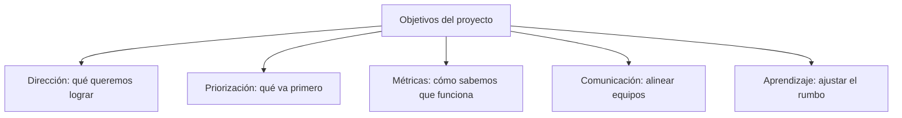

+++
title = "2. Los objetivos del proyecto"
weight = 2
+++

Definir objetivos es el primer paso porque orienta todas las decisiones posteriores: qué se hace primero, qué se mide, qué se descarta y qué recursos se asignan.

Un buen objetivo en transformación digital debe ser:

- **Claro**: cualquiera lo entiende.
- **Relevante**: conectado con una necesidad real del negocio o del usuario.
- **Medible**: con indicadores (KPIs) y umbrales.
- **Alcanzable**: realista con recursos y tiempo.
- **Con plazo**: horizonte temporal.

## Del “hacer” al “lograr”

Es común confundir **tareas** con **objetivos**:

- Tarea: “implantar una app”.
- Objetivo: “reducir el tiempo de atención al cliente un 25% en 6 meses”.

La tarea es un medio; el objetivo es el resultado.

## Ejemplo didáctico (objetivos típicos)

- **Experiencia de cliente**: mejorar tiempos de respuesta, reducir errores, aumentar satisfacción.
- **Eficiencia operativa**: automatizar pasos repetitivos, reducir retrabajos.
- **Calidad del dato**: unificar fuentes, mejorar consistencia.
- **Nuevos ingresos**: habilitar canales digitales, nuevos servicios.

**Conceptos clave:** **objetivos**, **KPIs**, **priorización**, **alineación**, **resultado vs tarea**.

**Caso real (simplificado):** un ayuntamiento quería “digitalizar trámites”. Al convertirlo en objetivos (“reducir visitas presenciales un 30% y tiempo medio de resolución un 20%”), pudieron decidir qué trámites atacar primero y qué métricas vigilar.

## Autoevaluación

1. Convierte esta tarea en objetivo: “implantar una app de citas” (hazlo **medible** y con **plazo**).
2. Nombra al menos dos características de un buen objetivo en transformación digital.
3. Propón un KPI para medir un objetivo de “mejorar la experiencia de cliente”.

Volver al índice

---

