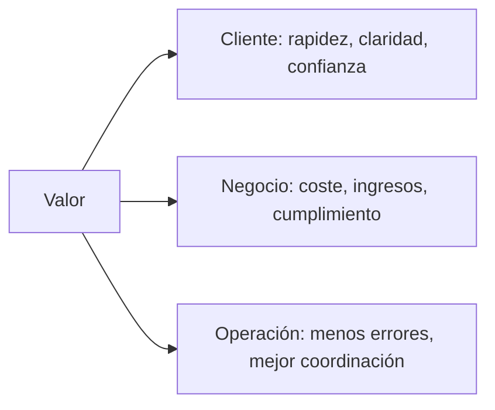

+++
title = "4. El valor del negocio"
weight = 4
+++

Un proyecto solo tiene sentido si entrega **valor**. En transformación digital, “valor” suele combinar:

- **Valor para el cliente/usuario** (mejor servicio, menos fricción, más confianza).
- **Valor para la organización** (menos costes, más ingresos, menos riesgos, más calidad).

## ¿Cómo se expresa el valor?

En términos prácticos, conviene traducir el valor a:

- **Indicadores** (KPIs): tiempo, coste, calidad, satisfacción.
- **Impacto**: en procesos críticos.
- **Evidencias**: datos antes/después.

## De la idea al caso de negocio (mini plantilla)

- Problema actual: ¿qué duele y a quién?
- Beneficio esperado: ¿qué mejora medible esperamos?
- Coste total: licencias, tiempo, formación, soporte.
- Riesgos: técnicos/organizativos.
- Alternativas: ¿qué pasa si no se hace?

### Tabla comparativa — medir valor

| Tipo de valor | Indicadores típicos | Ejemplos de evidencia |
|---|---|---|
| Eficiencia | tiempo de ciclo, coste por operación | informes antes/después, registros del sistema |
| Calidad | tasa de error, retrabajos, devoluciones | auditorías, tickets de incidencias |
| Experiencia | NPS, CSAT, abandono | encuestas, analítica de uso |
| Riesgo | incidentes, cumplimiento, brechas | auditorías, informes de seguridad |

**Conceptos clave:** **valor**, **KPIs**, **caso de negocio**, **coste total**, **evidencia**.

**Caso real (simplificado):** un e-commerce invirtió en una app móvil por “modernidad”. Al medir valor, descubrieron que el mayor beneficio estaba en optimizar el checkout web. Redirigieron el proyecto y lograron mejorar conversión con menor coste.

## Autoevaluación

1. Diferencia **valor para el cliente** vs **valor para la organización** con un ejemplo de cada uno.
2. Elige un objetivo y define un indicador para medirlo (tiempo/coste/calidad/satisfacción).
3. ¿Qué coste “oculto” suele olvidarse en proyectos digitales (formación, soporte, mantenimiento…)?

Volver al índice

---

