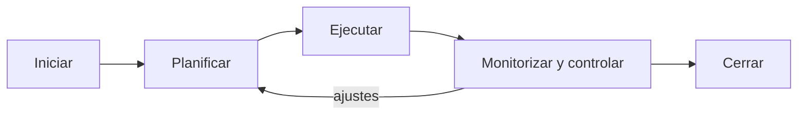
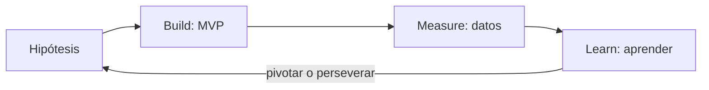
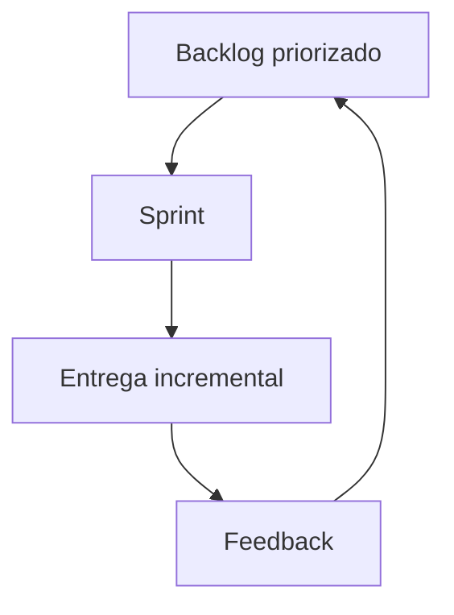

+++
title = "6. Gestión de proyectos"
weight = 6
+++

Gestionar un proyecto de transformación digital requiere combinar planificación y adaptación. En vez de “plan perfecto”, buscamos **control del avance** y **capacidad de ajuste**.

## Fases en la gestión de proyectos

Aunque cada organización lo adapte, es útil pensar en fases:

1. **Inicio**: alcance, stakeholders, objetivo, valor.
2. **Planificación**: tareas, hitos, riesgos, recursos, responsables.
3. **Ejecución**: desarrollo/implantación, formación, comunicación.
4. **Seguimiento y control**: métricas, calidad, cambios, riesgos.
5. **Cierre**: entrega, lecciones aprendidas, transición a operación.

**Conceptos clave:** **alcance**, **hitos**, **stakeholders**, **seguimiento**, **cierre**.

**Caso real (simplificado):** un proyecto implantó una herramienta, pero no cerró la fase de transición a operación (soporte, manuales, roles). A los dos meses se acumuló deuda operativa y se percibió como “fracaso”.

## Metodologías en la gestión de proyectos

No hay una “mejor” universal. Se elige según:

- Incertidumbre (¿sabemos bien lo que hay que construir?).
- Criticidad/regulación.
- Dependencias y tamaño.
- Cultura del equipo.

### Tabla comparativa — enfoques habituales

| Enfoque | Cuándo encaja mejor | Riesgo típico |
|---|---|---|
| Predictivo (planificado) | requisitos estables, alta regulación | poca flexibilidad ante cambios |
| Iterativo/Incremental | se puede entregar por partes | coordinación y priorización |
| Híbrido | partes estables + partes exploratorias | mala mezcla (doble burocracia) |

**Conceptos clave:** **predictivo**, **iterativo**, **incremental**, **híbrido**.

## Metodología lean startup

Lean Startup no es “hacer startups”; es una forma de reducir incertidumbre con aprendizaje rápido.

La idea central: construir lo mínimo para validar una hipótesis (MVP) y aprender.

_Ciclo Build-Measure-Learn para aprender rápido con evidencias._

Ejemplo de hipótesis:

- “Si ofrecemos recordatorios automáticos por WhatsApp, bajarán las ausencias un 15%”.

**Conceptos clave:** **MVP**, **hipótesis**, **métrica**, **pivotar**, **aprendizaje**.

**Caso real (simplificado):** un equipo planeó 6 meses de desarrollo para una app interna. En 2 semanas crearon un MVP con un formulario y automatización básica. Descubrieron que el problema real era de datos, no de interfaz, y ahorraron meses.

## Agile

Agile es un conjunto de principios para entregar valor de forma incremental, con feedback frecuente.

Características típicas:

- Trabajo por **iteraciones** (p. ej., sprints).
- **Backlog** priorizado por valor.
- Revisión frecuente con usuarios.
- Mejora continua (retrospectiva).

_Agile como bucle de entrega + feedback + ajuste._

Buenas prácticas para Agile en transformación digital:

- Definir “hecho” (Definition of Done): calidad, documentación mínima, seguridad.
- Medir entrega y calidad: lead time, defectos, satisfacción.
- No olvidar operación: soporte, formación, adopción.

**Conceptos clave:** **Agile**, **sprint**, **backlog**, **feedback**, **mejora continua**.

**Caso real (simplificado):** un equipo hacía sprints, pero sin demo a usuarios. Entregaban “features” que nadie usaba. Al incorporar feedback real y métricas de uso, reorientaron el backlog hacia lo que generaba valor.

## Autoevaluación

1. Enumera las 5 fases básicas de la gestión de proyectos.
2. ¿En qué situación elegirías un enfoque más **predictivo** y en cuál uno más **Agile**?
3. Define “MVP” con tus palabras y pon un ejemplo de MVP en un proceso del instituto.

> **Enlaces recomendados:** [Agile Manifesto](https://agilemanifesto.org/) · [Lean Startup (Wikipedia)](https://en.wikipedia.org/wiki/Lean_startup)

Volver al índice

---

