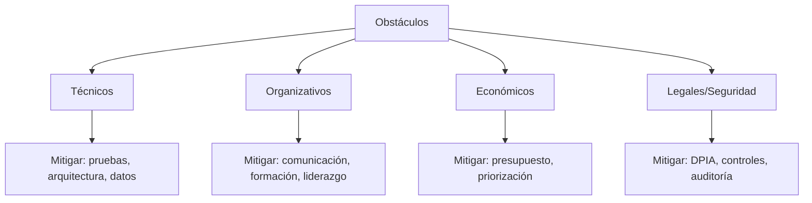
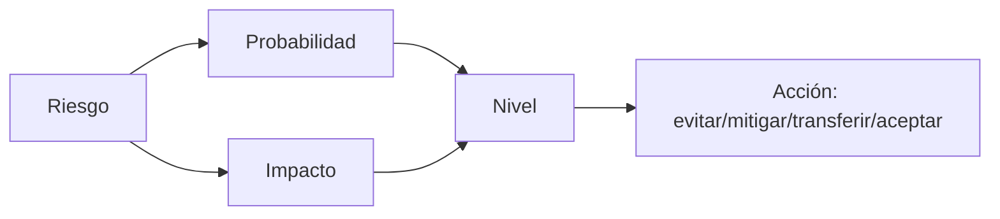

+++
title = "7. Identificación de obstáculos"
weight = 7
+++

Un proyecto se complica por obstáculos que pueden ser:

- **Técnicos**: integraciones, datos sucios, rendimiento.
- **Organizativos**: resistencias, falta de tiempo, prioridades cruzadas.
- **Económicos**: costes ocultos, licencias, soporte.
- **Legales/seguridad**: cumplimiento, privacidad, accesos.

La clave es identificarlos pronto, evaluarlos y definir mitigaciones.

**Conceptos clave:** **dependencias**, **riesgo**, **mitigación**, **incertidumbre**.

**Caso real (simplificado):** un proyecto se retrasó porque el dato maestro (clientes) era inconsistente entre sistemas. No era “problema de software”, sino de gobernanza de datos. Se resolvió creando reglas de calidad y responsables del dato.

## Matriz de riesgos

Una **matriz de riesgos** ayuda a ordenar qué riesgos son críticos.

1. Listar riesgos.
2. Estimar **probabilidad** e **impacto**.
3. Definir **respuesta**: evitar, mitigar, transferir, aceptar.
4. Asignar dueño y seguimiento.

### Plantilla mínima de registro de riesgos

| Riesgo | Prob. (1-5) | Impacto (1-5) | Nivel | Respuesta | Owner | Estado |
|---|---:|---:|---:|---|---|---|
| Datos inconsistentes | 4 | 5 | 20 | Mitigar: limpieza + reglas + pruebas | Data Owner | Abierto |
| Baja adopción | 3 | 5 | 15 | Mitigar: formación + champions + comunicación | RRHH/Change | Abierto |
| Dependencia proveedor | 2 | 4 | 8 | Transferir: SLA + plan B | Compras/TI | En seguimiento |

**Conceptos clave:** **probabilidad**, **impacto**, **registro de riesgos**, **owner**, **plan de respuesta**.

## Autoevaluación

1. Nombra dos obstáculos (técnico y organizativo) y una mitigación para cada uno.
2. ¿Cómo se obtiene el “nivel” de riesgo combinando probabilidad e impacto?
3. ¿Cuál es la diferencia entre **mitigar**, **transferir** y **aceptar** un riesgo?

Volver al índice

---

