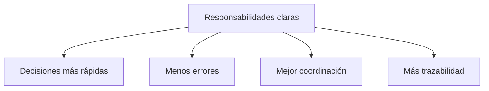

+++
title = "8. Asignación de responsabilidades"
weight = 8
+++

Una causa frecuente de problemas es que nadie sabe exactamente quién decide, quién ejecuta o quién valida. En transformación digital hay muchos actores: dirección, TI, negocio, soporte, legal, seguridad, usuarios…

Asignar responsabilidades reduce:

- Bloqueos (“¿quién aprueba esto?”)
- Duplicidades (“lo hice yo también”)
- Vacíos (“nadie lo hizo”)

**Conceptos clave:** **roles**, **accountability**, **gobernanza**, **decisión**, **toma de requisitos**.

**Caso real (simplificado):** el equipo TI desarrolló una funcionalidad que “negocio” nunca pidió. No había dueño del backlog. Al definir roles (product owner, sponsor, validadores), se redujeron malentendidos.

## Matriz RACI

La matriz **RACI** define responsabilidades por actividad:

- **R — Responsible (Responsable)**: quien ejecuta.
- **A — Accountable (Aprobador / Responsable último)**: quien responde del resultado.
- **C — Consulted (Consultado)**: aporta información.
- **I — Informed (Informado)**: se mantiene al tanto.

### Ejemplo de matriz RACI (simplificado)

| Actividad | Dirección | TI | Negocio | Legal/DPD | Usuarios clave |
|---|---|---|---|---|---|
| Definir objetivos OKR | A | C | R | C | C |
| Seleccionar herramienta | A | R | C | C | I |
| Migración de datos | I | R | C | C | I |
| Validación de procesos | I | C | A/R | C | R |
| Formación y adopción | I | C | R | I | A/R |

Buenas prácticas:

- Evitar varios **A** en la misma tarea.
- No llenar todo de **C** (ralentiza).
- Revisar la matriz cuando cambie el alcance.

**Conceptos clave:** **RACI**, **responsable**, **aprobador**, **consultado**, **informado**.

## Autoevaluación

1. Explica qué significa cada letra de RACI.
2. ¿Por qué “llenar todo de C (consultados)” puede ralentizar un proyecto?
3. Piensa en una tarea del proyecto: ¿quién debería ser “A” (accountable) y por qué?

Volver al índice

---

