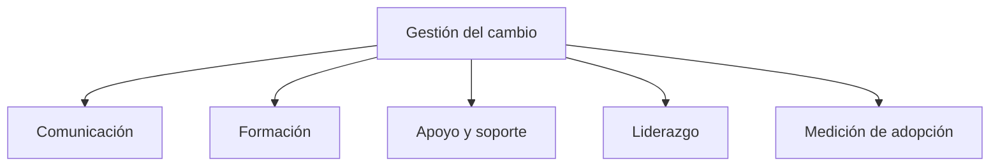

+++
title = "9. Gestión del cambio"
weight = 9
+++

La gestión del cambio es el conjunto de acciones para que la organización **adopte** el nuevo modo de trabajar. En transformación digital, el “producto final” no es la herramienta: es el **uso real**.

## ¿Qué suele fallar si no hay gestión del cambio?

- Formación insuficiente.
- Comunicaciones confusas.
- Miedo a perder control o empleo.
- Procesos nuevos que no encajan con el día a día.

## Estrategia didáctica de cambio (mínimo viable)

1. **Mensaje claro**: por qué cambiamos y qué ganamos.
2. **Stakeholders**: identificar afectados y resistencias.
3. **Formación por perfiles**: no todos necesitan lo mismo.
4. **Acompañamiento**: soporte inicial, guías, FAQs.
5. **Métricas de adopción**: uso activo, tareas completadas, incidencias.
6. **Refuerzo**: reconocer avances, ajustar procesos.

### Tabla comparativa — indicadores de adopción

| Indicador | Qué mide | Ejemplo |
|---|---|---|
| Activación | cuántos empiezan a usar | % usuarios que entran 1ª semana |
| Uso recurrente | hábito | usuarios activos/semana |
| Eficacia | si el proceso mejora | tiempo medio del trámite |
| Calidad | si se usa bien | % registros completos |
| Soporte | fricción | nº tickets y motivos |

**Conceptos clave:** **adopción**, **stakeholders**, **formación**, **comunicación**, **métricas de cambio**.

**Caso real (simplificado):** al cambiar a un sistema de tickets, la adopción fue baja. El problema no era la herramienta: faltaba explicar beneficios, y la formación era demasiado genérica. Se crearon “champions” por equipo, guías breves y métricas de uso; en 6 semanas la adopción se estabilizó.

## Autoevaluación

1. ¿Por qué en transformación digital el “producto final” es el **uso real** y no la herramienta?
2. Cita tres acciones concretas de la estrategia mínima de gestión del cambio.
3. Elige un indicador de adopción y explica qué te diría si sube o si baja.

Volver al índice

---

