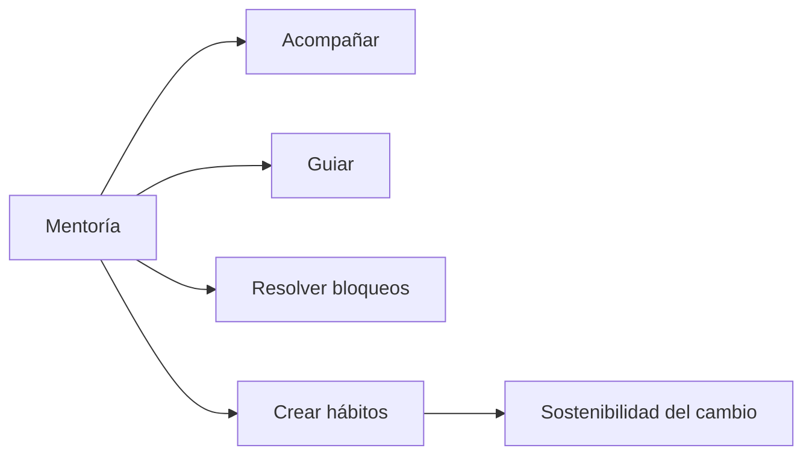

+++
title = "10. Mentoría"
weight = 10
+++

La mentoría en un proyecto de transformación digital consiste en acompañar a personas y equipos para que desarrollen competencias, resuelvan bloqueos y consoliden buenas prácticas.

No es “hacer el trabajo por otros”, sino facilitar aprendizaje y autonomía.

## ¿Qué aporta la mentoría?

- Acelera el aprendizaje de herramientas y procesos.
- Reduce resistencia (la gente se siente apoyada).
- Detecta problemas antes de que escalen.
- Construye comunidad (compartir soluciones).

## Formas sencillas de mentoría (aplicables en aula o empresa)

- **Sesiones cortas** de dudas (15–30 min) por rol.
- **Parejas** o “buddy system” para los primeros días.
- **Guías** de 1 página por proceso (cómo hago X).
- **Revisión** de casos reales (qué salió bien/mal y por qué).

## Mini plan de mentoría (plantilla)

- Objetivo: aumentar autonomía y adopción.
- Mentores: 1–2 personas por área.
- Ritmo: 2 sesiones/semana el primer mes, luego 1.
- Métricas: tickets, satisfacción, uso recurrente.

**Conceptos clave:** **mentoría**, **acompañamiento**, **autonomía**, **champions**, **sostenibilidad**.

**Caso real (simplificado):** tras implantar una herramienta de colaboración, el uso se disparó la primera semana y luego cayó. Con un plan de mentoría (champions + sesiones breves + ejemplos), se consolidaron hábitos y el uso se estabilizó.

## Autoevaluación

1. Diferencia mentoría de “soporte técnico” con un ejemplo.
2. Nombra dos formas sencillas de mentoría aplicables en aula o empresa.
3. ¿Qué métrica usarías para saber si la mentoría está funcionando?

Volver al índice

---

## Cierre (resumen final)

- Un proyecto de transformación digital se centra en **cambiar resultados**, no solo digitalizar.
- Los **objetivos** y el **valor** guían qué se hace y cómo se mide.
- OKR ayuda a convertir intención en métricas verificables.
- La gestión de proyectos, riesgos, responsabilidades y cambio determina el éxito.
- La mentoría hace que el cambio sea sostenible en el tiempo.
